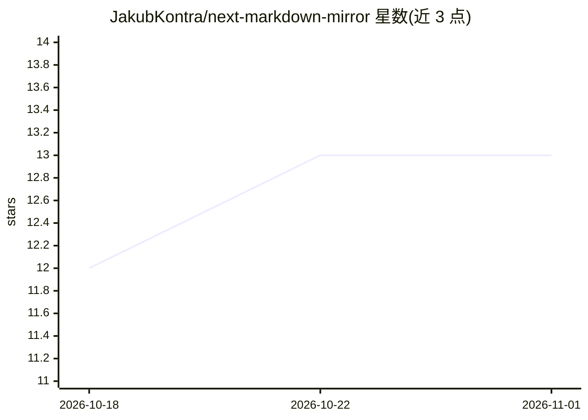

# JakubKontra/next-markdown-mirror

⭐ 13 · TypeScript · MIT · 推送 2026-03-27 · [GitHub](https://github.com/JakubKontra/next-markdown-mirror) · 个人维护

**自托管 Next.js 库：向 AI 代理输出页面 Markdown 而非 HTML**

面向 Next.js 站点所有者的 npm 库：通过 proxy/middleware 与路由处理器拦截 AI 代理的 Markdown 请求，内部抓取 HTML 并转换为 GFM+扩展 Markdown，剥离导航、页脚、脚本、广告等噪音以降低 token 消耗。内置 llms.txt 发现文件生成、JSON-LD 转 YAML frontmatter、token 计数响应头与 Content-Signal 头。转换器可脱离 Next.js 独立使用，支持 App Router 与 Pages Router 两种接入方式。

## 筛选速览

| 维度 | 判定 | 备注 |
|---|---|---|
| AI 角色 | `ai-ecosystem` | LLM/agent 周边工具 |
| 许可风险 | `permissive` | MIT |
| 部署形态 | `library` | 以包/库形式分发 |
| 模型依赖 | — | README 未给出锁定关系 |
| 硬件要求 | — | 无带数字的原话,不猜 |
| 安装摩擦 | `low` | 无编译、无系统依赖或容器化 |
| 成熟度 | — | 结构信号不足 |

## 能力要点

- HTML→Markdown 转换并过滤导航/页脚/广告等噪音内容
- 内置 llms.txt 协议发现文件生成
- JSON-LD 提取为 YAML frontmatter
- HtmlToMarkdown 转换器可脱离 Next.js 独立使用

## 适用场景

- 让 AI 爬虫和代理以更低 token 成本读取我的站点内容
- 为站点提供 llms.txt 与 Content-Signal 声明
- 在自托管环境替代 Cloudflare 付费的 Markdown 转换服务

## 场景标签

`网页抓取` · 领域:效率与自动化

## 证据(README 行号)

> L10: **Self-hosted Markdown for AI agents** — serve clean Markdown instead of HTML when AI agents request your pages. Fu
> L114: - **llms.txt protocol** — built-in AI discovery file generation
> L122: The converter works standalone without Next.js:

## 星数曲线

2026-10-18 12 → 2026-11-01 13（+1）

---
*卡片 v1 · prompt 1.4 · 生成 2026-10-31 · 置信度 high · 依据 README sha `7babc0f6354d` · [字段定义](../../DATASET.md)*
