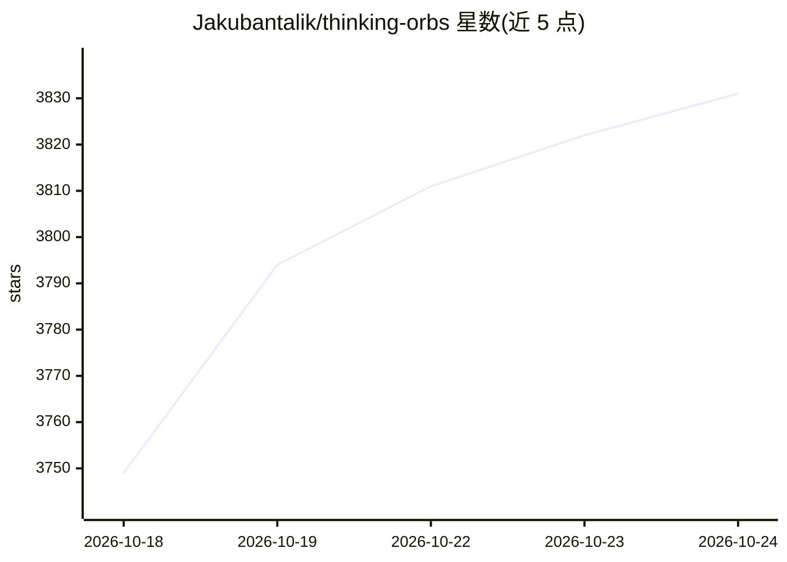

# Jakubantalik/thinking-orbs

⭐ 3,831 · TypeScript · MIT · 推送 2026-08-16 · [GitHub](https://github.com/Jakubantalik/thinking-orbs) · [官网](orbs.jakubantalik.com) · 个人维护

**给 AI/Agent 界面的点阵思考加载指示器组件**

面向 AI 与 agent 前端界面的加载动画 React 组件库：提供 9 种按 agent 动作词设计的点阵轨道动画状态（working/searching/solving 等），每种配 64px 头像尺寸与 20px 行内尺寸两套独立调校的设计。基于纯 2D canvas 渲染，不使用 WebGL 与滤镜，在 Chrome/Safari/Firefox 表现一致。支持自动深浅色主题（data-theme、prefers-color-scheme、SSR 安全三层解析）、prefers-reduced-motion 静态帧、离屏与隐藏标签页自动暂停。以 npm 包提供，MIT 许可，个人维护。

## 筛选速览

| 维度 | 判定 | 备注 |
|---|---|---|
| AI 角色 | `ai-ecosystem` | LLM/agent 周边工具 |
| 许可风险 | `permissive` | MIT |
| 部署形态 | `library` | 以包/库形式分发 |
| 模型依赖 | — | README 未给出锁定关系 |
| 硬件要求 | — | 无带数字的原话,不猜 |
| 安装摩擦 | `low` | 无编译、无系统依赖或容器化 |
| 成熟度 | — | 结构信号不足 |

## 能力要点

- 9 种 agent 动作状态动画，两套独立调校尺寸（64/20）
- 纯 2D canvas 渲染，无 WebGL/滤镜，跨浏览器一致
- 三层解析的自动深浅色主题，跟随宿主项目与系统实时切换
- 内置无障碍（aria-label）与性能优化（离屏暂停、共享时钟）

## 适用场景

- 为聊天/Agent 界面在等待模型响应时显示状态动画
- 在助手消息旁以行内尺寸显示当前动作指示
- 深浅色主题自动适配的前端项目直接嵌入加载指示器

## 场景标签

 · 领域:前端 UI 组件

## 证据(README 行号)

> L3: Dotted thought-orb loading indicators for AI & agent UIs. Nine hand-tuned animated states, each shipped at two purpo
> L25: Nine verbs an agent can be doing, each a distinct animation:

## 星数曲线

2026-10-18 3,749 → 2026-10-24 3,831（+82）

---
*卡片 v1 · prompt 1.4 · 生成 2026-10-20 · 置信度 high · 依据 README sha `a5c2e1e2f917` · [字段定义](../../DATASET.md)*
