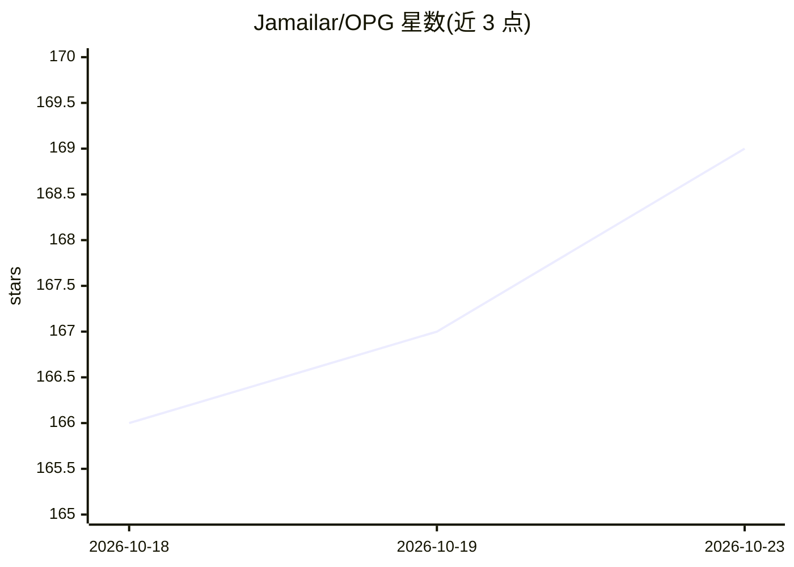

# Jamailar/OPG

⭐ 169 · TypeScript · NOASSERTION · 推送 2026-10-02 · [GitHub](https://github.com/Jamailar/OPG) · [官网](https://opg.ceo/) · 个人维护 · 中文 README

**面向一人公司的多 app 后端控制平面，统一 AI 网关与运营能力**

前后端分离 monorepo 形式的 app 后端集群控制平面，把认证、租户、配置、AI Gateway（OpenAI/Gemini 兼容 API、模型路由、provider 健康、成本账本）、视频长任务、支付、消息、用量与审计收进同一套系统，附带平台管理后台。接入以 CLI 为第一入口，人和 AI agent 都可通过 @jamba/opg-cli、stdio MCP、OpenAPI 或 opg-sdk 操作后端，兼容 Codex、Claude Code、Hermes、OpenClaw 等工具。部署优先 Docker，源码启动面向开发者。许可证为 PolyForm Noncommercial。

## 筛选速览

| 维度 | 判定 | 备注 |
|---|---|---|
| AI 角色 | `ai-ecosystem` | LLM/agent 周边工具 |
| 许可风险 | `none` | NOASSERTION |
| 部署形态 | `self-host` | docker 或自建部署 |
| 模型依赖 | — | README 未给出锁定关系 |
| 硬件要求 | — | 无带数字的原话,不猜 |
| 安装摩擦 | `low` | 无编译、无系统依赖或容器化 |
| 成熟度 | — | 结构信号不足 |

## 能力要点

- OpenAI/Gemini 兼容的 AI Gateway：模型路由、provider 健康、成本账本与审计事件
- @jamba/opg-cli 同时面向人和 agent：浏览器授权、app 创建、smoke test、数据库工作台、MCP server
- 覆盖认证/租户/支付/上传/短信邮件/可观测等 app 后端常用模块
- 文生视频/图生视频异步任务与结果代理

## 适用场景

- 一人公司用一套后端支撑多个 app 的认证、支付与运营
- 让 Codex/Claude Code 等 coding agent 通过 MCP/CLI 直接操作后端能力
- 统一管理多家 AI provider 的模型路由、用量与成本

## 场景标签

`模型网关` · 领域:Agent 开发

## 证据(README 行号)

> L243: ### 4. AI Gateway
> L135: 接入方式以 CLI 为第一入口。用户和 AI agent 都可以直接通过 `@jamba/opg-cli` 操作后端：创建 app、登录授权、读取 manifest、跑 smoke test、查询数据库工作区、提交 AI/视频任
> L288: 负责把 OPG 能力暴露给用户项目、CLI、coding agent 和任意支持 MCP / OpenAPI / SDK 的 AI 工具。

## 星数曲线

2026-10-18 166 → 2026-10-23 169（+3）

---
*卡片 v1 · prompt 1.4 · 生成 2026-10-22 · 置信度 high · 依据 README sha `523fc302ba81` · [字段定义](../../DATASET.md)*
