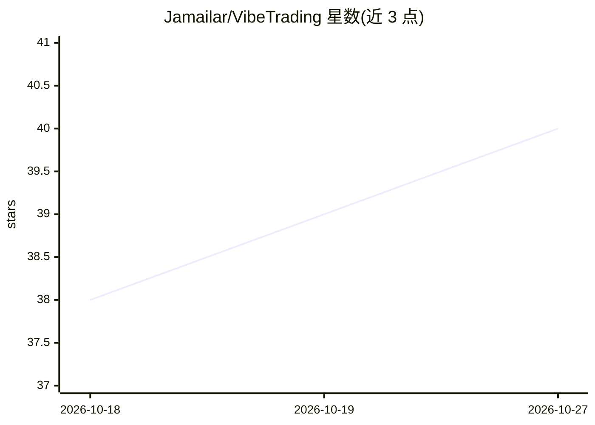

# Jamailar/VibeTrading

⭐ 40 · TypeScript · NOASSERTION · 推送 2025-12-13 · [GitHub](https://github.com/Jamailar/VibeTrading) · 组织维护 · 中文 README

**对话式创建量化交易策略并回测的开源桌面应用**

基于 Electron 的开源桌面应用（macOS/Windows/Linux），用户通过与 AI 对话生成量化交易策略并立即回测，支持美股、港股与比特币等市场，面向好奇者、学习者与独立开发者。AI 层使用 LangChain + LangGraph，支持 OpenAI、Anthropic Claude、Google Gemini 三种服务，可主动编辑策略文件并给出 diff 预览与 Accept/Reject 确认；策略代码在 VM2 沙箱中执行，数据存于本地 DuckDB，回测输出 CAGR、Sharpe、最大回撤等指标。项目源于 Miyoo AI Club 社区活动，采用 MIT（非商业）许可。

## 筛选速览

| 维度 | 判定 | 备注 |
|---|---|---|
| AI 角色 | `ai-native` | 本体是模型或模型工具 |
| 许可风险 | `none` | NOASSERTION |
| 部署形态 | `desktop` | 安装包/桌面程序 |
| 模型依赖 | — | README 未给出锁定关系 |
| 硬件要求 | — | 无带数字的原话,不猜 |
| 安装摩擦 | `low` | 无编译、无系统依赖或容器化 |
| 成熟度 | — | 结构信号不足 |

## 能力要点

- 对话生成交易策略并立即回测（CAGR/Sharpe/最大回撤等指标）
- AI 编辑策略文件，带 diff 预览与 Accept/Reject 确认及三种编辑模式
- 策略代码在 VM2 沙箱中执行，数据存储于本地 DuckDB
- 支持美股、港股与比特币等市场数据（加密货币免费，股票需 Polygon Key）

## 适用场景

- 用自然语言描述想法并让 AI 生成和修改交易策略
- 在本地桌面应用中回测策略并查看性能指标
- 以对话式方式学习量化策略构建

## 场景标签

`金融量化` · 领域:学习与行业

## 证据(README 行号)

> L9: VibeTrading 是一个基于 Electron 的开源桌面应用，让人们通过与 AI 聊天的方式创建量化交易策略、并立即完成回测，支持美股、港股与比特币等市场。它不是给专业量化团队的黑箱，而是面向好奇者、学习者与独立开发者的开放
> L15: - 🤖 **AI 策略生成** - 使用 LangChain + LangGraph 通过对话生成交易策略，支持流式输出
> L19: - 📊 **回测引擎** - 完整的回测系统，支持多种性能指标

## 星数曲线

2026-10-18 38 → 2026-10-27 40（+2）

---
*卡片 v1 · prompt 1.4 · 生成 2026-10-25 · 置信度 high · 依据 README sha `6dee9f80edda` · [字段定义](../../DATASET.md)*
