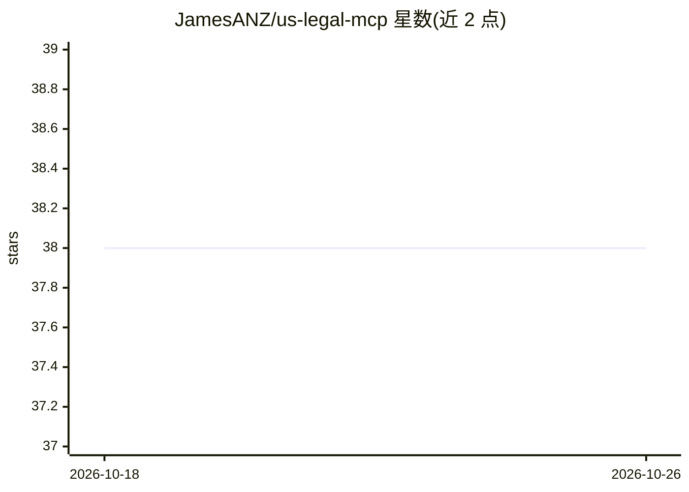

# JamesANZ/us-legal-mcp

⭐ 38 · TypeScript · MIT · 推送 2026-10-15 · [GitHub](https://github.com/JamesANZ/us-legal-mcp) · [官网](https://glama.ai/mcp/servers/@JamesANZ/us-legal-mcp) · 个人维护

**向 AI 工作流提供美国法律检索的 MCP 服务器**

一个 MCP (Model Context Protocol) 服务器，将 Congress.gov、Federal Register、CourtListener、GovInfo 及 OCC/SEC/CFTC 等监管机构新闻源接入 Cursor、Claude Desktop 等 AI 环境。提供法案检索、法案文本版本、法院判例、多源联合检索与数字资产立法（GENIUS Act、CLARITY Act）策展查询等工具。无需 API key 即可运行（可选 key 获得增强访问），可选设置 Jev/TypeSafe key 做高置信度结果过滤，未设置时回退关键词评分。通过 npm 全局安装或源码构建，需 Node.js 18+。

## 筛选速览

| 维度 | 判定 | 备注 |
|---|---|---|
| AI 角色 | `ai-ecosystem` | LLM/agent 周边工具 |
| 许可风险 | `permissive` | MIT |
| 部署形态 | `library` | 以包/库形式分发 |
| 模型依赖 | — | README 未给出锁定关系 |
| 硬件要求 | — | 无带数字的原话,不猜 |
| 安装摩擦 | `low` | 无编译、无系统依赖或容器化 |
| 成熟度 | — | 结构信号不足 |

## 能力要点

- 覆盖 Congress/Federal Register/CourtListener/GovInfo 及 6 个监管机构新闻源
- 无需 API key 开箱即用，可选 key 增强访问
- 可选 Jev 高置信度过滤（默认阈值 0.85），不可用时回退关键词评分
- 数字资产立法策展查询（GENIUS Act、CLARITY Act）

## 适用场景

- 法律研究者快速检索法案、法规与法院判例
- 政策分析师追踪立法与监管动态
- 开发者在其应用中接入权威法律数据

## 场景标签

`科研工具` · 领域:学习与行业

## 证据(README 行号)

> L5: An MCP (Model Context Protocol) server that brings authoritative US legal information into AI coding environments li
> L220: **Built with:** Node.js, TypeScript, MCP SDK

## 星数曲线

2026-10-18 38 → 2026-10-26 38（+0）

---
*卡片 v1 · prompt 1.4 · 生成 2026-10-25 · 置信度 high · 依据 README sha `dc5e5115cc9e` · [字段定义](../../DATASET.md)*
