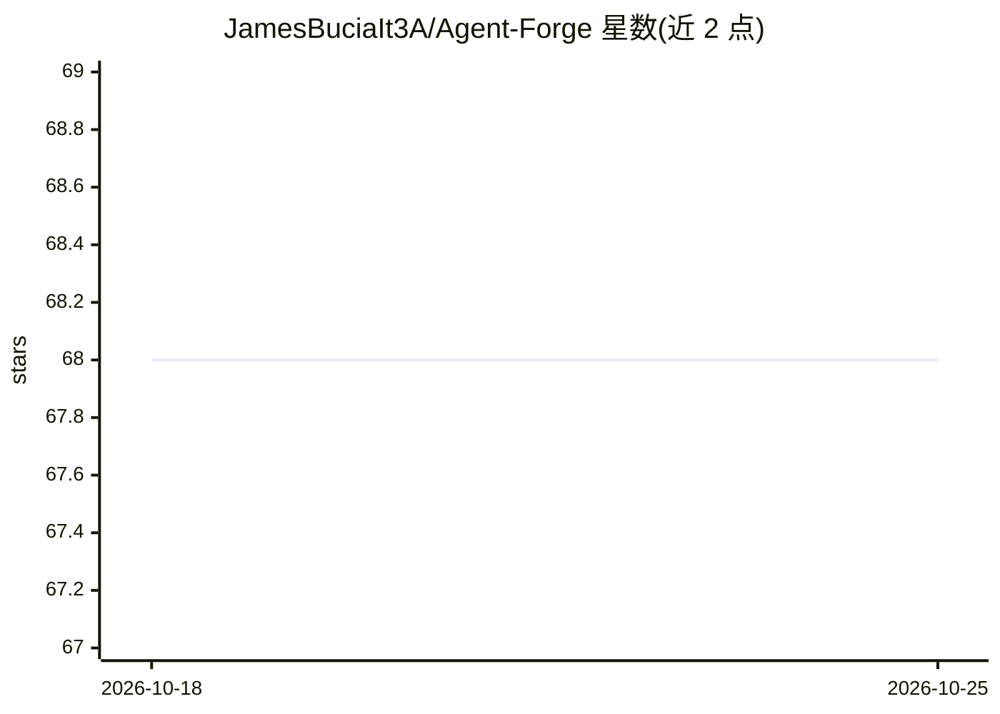

# JamesBuciaIt3A/Agent-Forge

⭐ 68 · HTML · 推送 2026-10-25 · [GitHub](https://github.com/JamesBuciaIt3A/Agent-Forge) · 个人维护

**面向编码代理的网站交付流程手册：契约、质量门与决策账本**

Foreman Continuum 是一套供使用 AI 编码代理构建生产网站的团队采用的构建手册、编排层与质量门体系。核心机制为：生成前以任务契约限定代理范围与验收标准；适配器将契约翻译为具体代理的提示词，实现代理无关的可替换性；每阶段以确定性质量门收尾；决策账本追加记录变更与理由。包含 /playbook、/contracts、/gates、/adapters、/ledger、/site 参考实现等目录。以自包含捆绑包形式下载分发，MIT 许可，声明按现状提供、需保留人工审核环节。

## 筛选速览

| 维度 | 判定 | 备注 |
|---|---|---|
| AI 角色 | `ai-ecosystem` | LLM/agent 周边工具 |
| 许可风险 | `none` | — |
| 部署形态 | `None` |  |
| 模型依赖 | — | README 未给出锁定关系 |
| 硬件要求 | — | 无带数字的原话,不猜 |
| 安装摩擦 | `low` | 无编译、无系统依赖或容器化 |
| 成熟度 | — | 结构信号不足 |

## 能力要点

- 任务契约在生成前定义代理范围、边界与验收标准
- 适配器层隔离契约与具体代理，支持更换模型而不重写流程
- 每阶段确定性质量门与独立复核（复核与生成非同一过程）
- 追加式决策账本记录变更理由，含密钥不入账本、依赖锁定等安全默认

## 适用场景

- 团队用多个编码代理交付网站时保持流程一致与可审计
- 为新加入的代理或贡献者传递约束而非依赖记忆
- 希望每个交付物留下人类可读决策记录的项目

## 场景标签

 · 领域:AI 辅助开发/工作流

## 证据(README 行号)

> L8: Foreman Continuum is a build playbook, orchestration layer, and quality gate system for teams who use coding agents 
> L45: - **/adapters** — Thin shims that translate a contract into a prompt for a specific agent.
> L106: Adapters are the thinnest possible layer between a contract and a specific agent. They do not contain business log

## 星数曲线

2026-10-18 68 → 2026-10-25 68（+0）

---
*卡片 v1 · prompt 1.4 · 生成 2026-10-24 · 置信度 mid · 依据 README sha `cf654fcf2006` · [字段定义](../../DATASET.md)*
