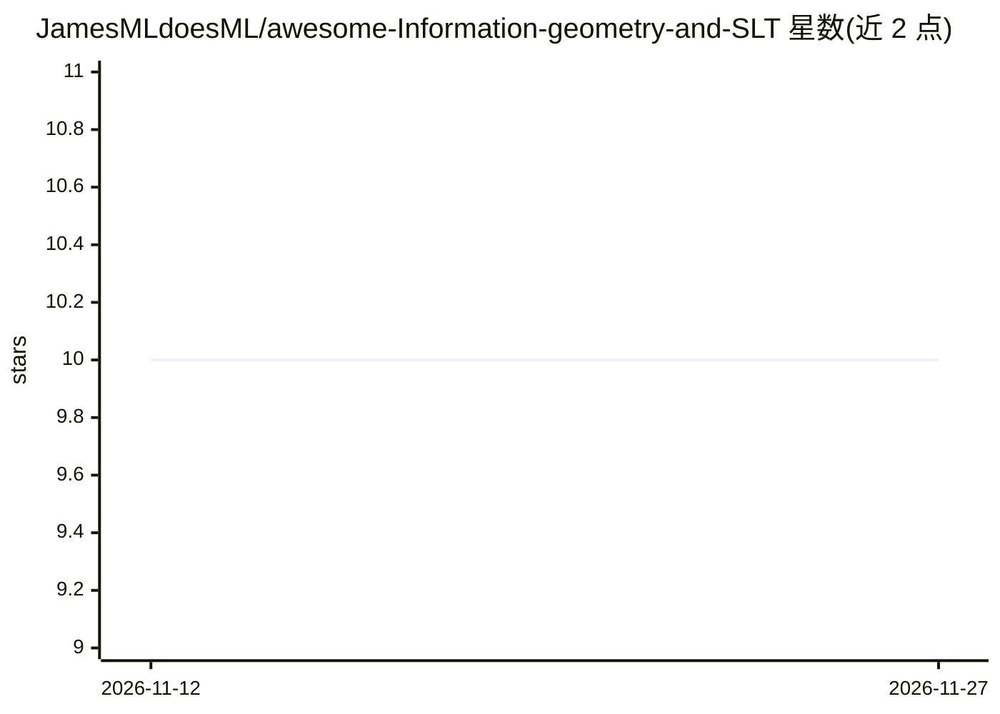

# JamesMLdoesML/awesome-Information-geometry-and-SLT

⭐ 10 · Shell · NOASSERTION · 推送 2026-10-29 · [GitHub](https://github.com/JamesMLdoesML/awesome-Information-geometry-and-SLT) · 个人维护

**信息几何与奇异学习理论的学习资源策展清单**

面向信息几何与奇异学习理论两个方向的资源聚合清单，收录教科书、讲义、教程综述、博客、经典与前沿论文及入门视频。结构分两部分：第一部分按子领域组织核心概念的学习材料（如 Amari、Watanabe 的教材与 Nielsen 的综述），第二部分汇集近年机器学习研究论文。作者自述为个人策展，欢迎社区贡献补充条目。

## 筛选速览

| 维度 | 判定 | 备注 |
|---|---|---|
| AI 角色 | `ai-knowledge` | 知识聚合/清单类 |
| 许可风险 | `none` | NOASSERTION |
| 部署形态 | `None` |  |
| 模型依赖 | — | README 未给出锁定关系 |
| 硬件要求 | — | 无带数字的原话,不猜 |
| 安装摩擦 | `low` | 无编译、无系统依赖或容器化 |
| 成熟度 | — | 结构信号不足 |

## 能力要点

- 覆盖教科书、讲义、教程、博客、论文、视频等多种资源类型
- 按信息几何与奇异学习理论两个子领域及学习阶段组织条目
- 包含自然梯度、神经网络几何、贝叶斯统计等 ML 相关论文

## 适用场景

- 系统入门信息几何与 Fisher 信息矩阵相关理论
- 查找奇异学习理论（Watanabe 学派）的经典文献与讲义
- 跟踪信息几何在机器学习中的最新研究进展

## 场景标签

`精选清单` · 领域:学习与行业

## 证据(README 行号)

> L1: # Awesome Information Geometry & Singular Learning Theory Awesome
> L3: A curated list of tutorials, textbooks, papers, and talks on information geometry and singular learning theory, from
> L5: The core idea of information geometry is to study the parameter space of statistical models as Riemannian manifold w

## 星数曲线

2026-11-12 10 → 2026-11-27 10（+0）

---
*卡片 v1 · prompt 1.4 · 生成 2026-11-20 · 置信度 high · 依据 README sha `db5eb5c74c88` · [字段定义](../../DATASET.md)*
