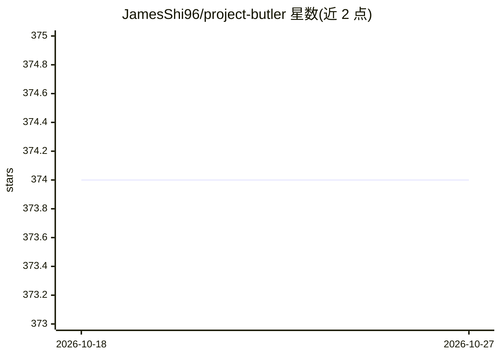

# JamesShi96/project-butler

⭐ 374 · Shell · MIT · 推送 2026-07-29 · [GitHub](https://github.com/JamesShi96/project-butler) · 个人维护 · 中文 README

**为 AI 编码助手提供跨会话项目记忆的 Claude Code 技能**

以 Claude Code skill 形式安装的项目记忆系统：通过 /project-butler 初始化，在项目内维护纯 Markdown 文件（规则、项目 wiki、TODO、会话日志、交接记录等），用 end session 保存进度、continue 恢复上下文。内部使用 7 组件记忆栈按稳定性分层组织，并维护机器可读的项目 profile。支持生成 Cursor 规则文件与 Codex 的 AGENTS.md，使多工具共享同一份项目记忆；任何能读项目文件的 AI 助手均可使用。要求 Claude Code CLI 与 jq。

## 筛选速览

| 维度 | 判定 | 备注 |
|---|---|---|
| AI 角色 | `ai-ecosystem` | LLM/agent 周边工具 |
| 许可风险 | `permissive` | MIT |
| 部署形态 | `None` |  |
| 模型依赖 | locked-api |  |
| 硬件要求 | — | 无带数字的原话,不猜 |
| 安装摩擦 | `low` | 无编译、无系统依赖或容器化 |
| 成熟度 | — | 结构信号不足 |

## 能力要点

- 维护纯 Markdown 项目记忆文件（规则/wiki/TODO/会话日志/交接）
- 7 组件记忆栈按稳定性分层组织
- 生成 Cursor 规则与 Codex AGENTS.md，多工具共享项目记忆
- 每日自动检查上游更新，支持中英双语项目文件

## 适用场景

- 让 Claude Code 在新会话中恢复上次项目进度，不必重新解释背景
- 在 Claude Code、Cursor、Codex 间切换时保持同一份项目记忆
- 把项目规则、决策与 TODO 固化为 AI 可读的长期记忆

## 场景标签

`Agent 记忆` · 领域:Agent 开发

## 证据(README 行号)

> L10: > Make AI coding agents remember your project between sessions.
> L181: |Claude Code|Native skill|Install this repo under `~/.claude/skills/project-butler` and run `/project-butler`.|

## 星数曲线

2026-10-18 374 → 2026-10-27 374（+0）

---
*卡片 v1 · prompt 1.4 · 生成 2026-10-21 · 置信度 high · 依据 README sha `81eb4d3ce0c0` · [字段定义](../../DATASET.md)*
