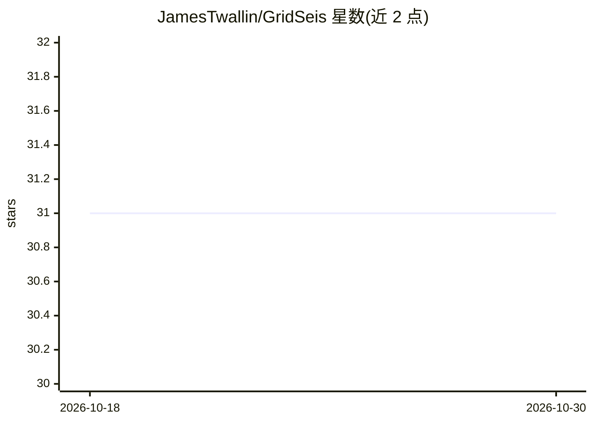

# JamesTwallin/GridSeis

⭐ 31 · Python · MIT · 推送 2025-12-10 · [GitHub](https://github.com/JamesTwallin/GridSeis) · 个人维护

**用 FFT 分析电网频率数据预测碳排放强度的机器学习项目**

研究型项目，验证英国电网频率数据中蕴含碳排放强度信息：以 1 秒分辨率的电网频率数据为唯一输入，按 30 分钟分块做 FFT 分解提取频率特征，再用滚动窗口（1h/3h/6h）构造衍生特征，训练 XGBoost 回归模型预测碳强度，不依赖发电结构数据。数据覆盖 2023 年 7 月至 2024 年 12 月，另设 2024 年 12 月后的验证集评估泛化。提供 conda 环境创建与 pip 依赖安装方式，运行两个 Python 脚本完成绘图与建模。

## 筛选速览

| 维度 | 判定 | 备注 |
|---|---|---|
| AI 角色 | `ai-native` | 本体是模型或模型工具 |
| 许可风险 | `permissive` | MIT |
| 部署形态 | `library` | 以包/库形式分发 |
| 模型依赖 | — | README 未给出锁定关系 |
| 硬件要求 | — | 无带数字的原话,不猜 |
| 安装摩擦 | `low` | 无编译、无系统依赖或容器化 |
| 成熟度 | — | 结构信号不足 |

## 能力要点

- 仅以电网频率数据为输入预测碳排放强度，无需发电结构数据
- FFT 分解 + 滚动窗口特征 + XGBoost 回归的完整流程
- 使用 2024 年 12 月之后的时间外验证集评估泛化能力

## 适用场景

- 在缺少发电结构数据的地区估算电网碳排放强度
- 研究电网频率特征与碳强度的关系
- 为离线智能设备择时用电提供碳强度信号参考

## 场景标签

`数据分析` · 领域:效率与自动化

## 证据(README 行号)

> L5: "GridSeis" uses FFT analysis and machine learning to predict carbon intensity through 1d grid frequency data alone. 
> L44: 5. Training an XGBoost model to predict carbon intensity

## 星数曲线

2026-10-18 31 → 2026-10-30 31（+0）

---
*卡片 v1 · prompt 1.4 · 生成 2026-10-26 · 置信度 high · 依据 README sha `4988021b9c4f` · [字段定义](../../DATASET.md)*
