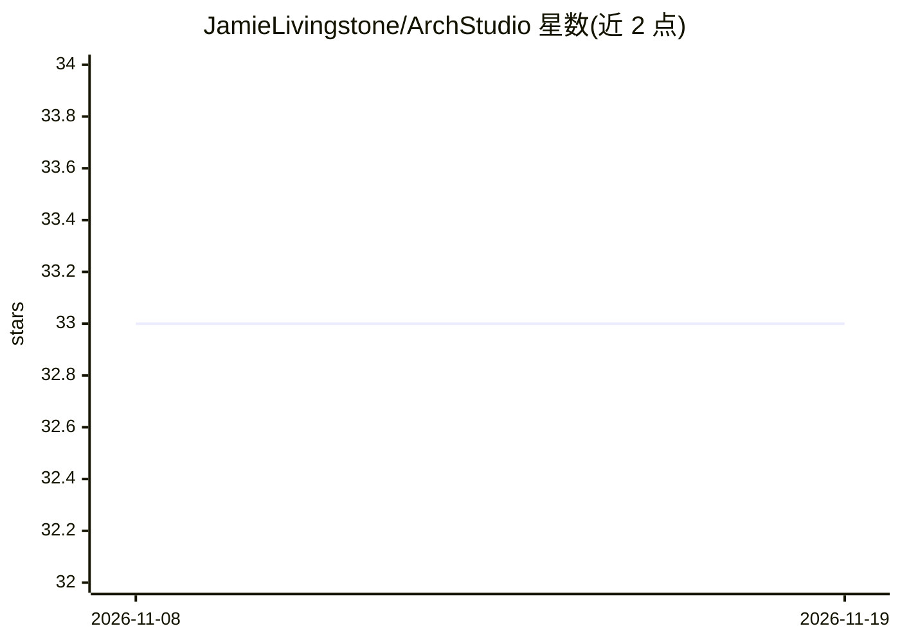

# JamieLivingstone/ArchStudio

⭐ 33 · TypeScript · MIT · 推送 2026-11-16 · [GitHub](https://github.com/JamieLivingstone/ArchStudio) · [官网](https://archstudio.app) · 个人维护

**理解系统架构的架构图编辑器，AI 改动可像 PR 逐条审阅**

面向软件开发者与系统设计者的架构图编辑器，运行于 Web 与 macOS/Windows/Linux 桌面端。组件带有真实属性（数据库可设复制、分区、一致性，队列可设投递保证、重试等），图保存为纯 JSON 可入 git。AI 部分可选：接入用户自己的 Anthropic 或 OpenAI key，助手读取真实组件回答问题、审查风险，提出的修改在画布上标注并以 diff 形式逐条接受或拒绝；编辑器本身不依赖 AI 也可完整使用。桌面版未付费签名，首次运行有系统警告；自述处于 beta。

## 筛选速览

| 维度 | 判定 | 备注 |
|---|---|---|
| AI 角色 | `ai-enhanced` | 去掉 AI 部分产品仍成立 |
| 许可风险 | `permissive` | MIT |
| 部署形态 | `None` |  |
| 模型依赖 | — | README 未给出锁定关系 |
| 硬件要求 | — | 无带数字的原话,不猜 |
| 安装摩擦 | `low` | 无编译、无系统依赖或容器化 |
| 成熟度 | `idea` | |

## 能力要点

- 29 种真实组件，各带可配置属性与权衡说明
- AI 修改以 diff 呈现，可逐条接受/拒绝并一步撤销
- 接入用户自有 Anthropic/OpenAI key，默认无账号无云同步
- 图保存为可 diff 的纯 JSON 文件

## 适用场景

- 设计并记录软件系统架构，文件纳入 git 管理
- 用自然语言描述改动，再像审 PR 一样审阅 AI 对架构的修改
- 让 AI 基于真实组件回答问题并审查设计风险与缺口

## 场景标签

 · 领域:软件开发/架构设计工具

## 证据(README 行号)

> L48: ArchStudio is a complete editor without AI. Connect your own Anthropic or OpenAI key, and the assistant never touch
> L23: - **AI that understands your system:** it reads your real components and their options, not a picture, so it can an

## 星数曲线

2026-11-08 33 → 2026-11-19 33（+0）

---
*卡片 v1 · prompt 1.4 · 生成 2026-11-18 · 置信度 high · 依据 README sha `8dfd1d3b0b53` · [字段定义](../../DATASET.md)*
