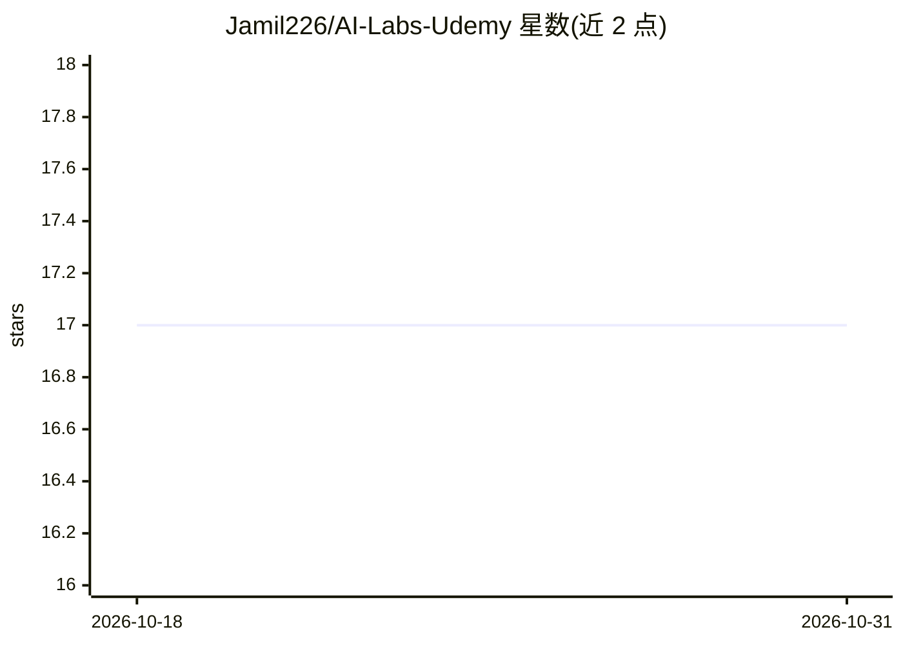

# Jamil226/AI-Labs-Udemy

⭐ 17 · Jupyter Notebook · 推送 2025-12-18 · [GitHub](https://github.com/Jamil226/AI-Labs-Udemy) · 个人维护

**Udemy AI 课程的配套实验代码库（Python 到 LLM/视觉）**

覆盖 AI 与数据科学教学大纲的实验作业仓库，共 10 个 Lab：Python 基础与面向对象、搜索排序算法（BFS/DFS）、Pandas/NumPy 数据分析与可视化、BeautifulSoup 网页抓取、Hugging Face 文本摘要与模型微调、OpenCV 与 YOLOv8 目标检测/分割、MLFlow 模型跟踪、Streamlit 应用开发、Arduino 机器人项目。面向课程学生，通过 git clone 获取，配合 Jupyter/Colab/VS Code 等工具运行；部分内容标注为进行中。

## 筛选速览

| 维度 | 判定 | 备注 |
|---|---|---|
| AI 角色 | `ai-knowledge` | 知识聚合/清单类 |
| 许可风险 | `none` | — |
| 部署形态 | `None` |  |
| 模型依赖 | — | README 未给出锁定关系 |
| 硬件要求 | — | 无带数字的原话,不猜 |
| 安装摩擦 | `low` | 无编译、无系统依赖或容器化 |
| 成熟度 | — | 结构信号不足 |

## 能力要点

- 10 个 Lab 覆盖 Python、数据分析、LLM 微调、计算机视觉、MLFlow、Streamlit、机器人
- 含 Hugging Face 文本摘要微调与 YOLOv8 检测/分割实验
- Pandas/NumPy 数据分析含 Kaggle 数据集实践
- MLFlow 跟踪服务器、模型注册与项目集成实验

## 适用场景

- 跟随课程系统练习 AI 与数据科学实验
- 查找 Pandas、OpenCV、MLFlow 等工具的入门示例
- 学习 LLM 微调与目标检测的动手流程

## 场景标签

`教程课程` · 领域:学习与行业

## 证据(README 行号)

> L22: # AI Course - Lab Work
> L24: Welcome to the AI Labs! This repository contains the lab work for the course, covering fundamental and advanced Pyt

## 星数曲线

2026-10-18 17 → 2026-10-31 17（+0）

---
*卡片 v1 · prompt 1.4 · 生成 2026-10-30 · 置信度 high · 依据 README sha `e207ff2cfae2` · [字段定义](../../DATASET.md)*
