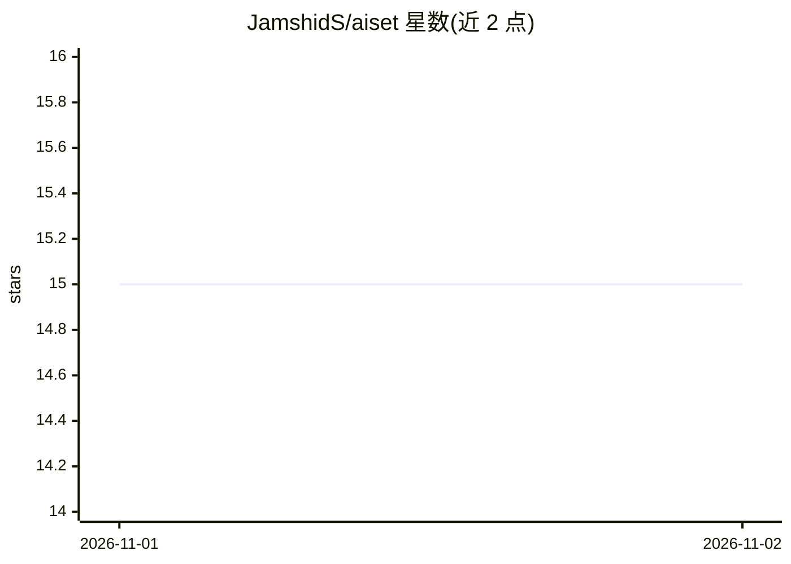

# JamshidS/aiset

⭐ 15 · Python · MIT · 推送 2026-10-31 · [GitHub](https://github.com/JamshidS/aiset) · [官网](https://pypi.org/project/aiset-cli/) · 个人维护

**把仓库变成带持久记忆的 Claude Code 多 agent 团队**

面向使用 Claude Code 的开发者：`aiset-init` 扫描一个或多个仓库，生成 PM、每仓库/栈一名工程师、QA 与集成检查员等 subagent 文件，写入 `<folder>/.claude/`。约定与经验以 Markdown/JSON 简报和任务剧集形式保存在工作区，跨任务复用。本地仪表盘（仅绑定 127.0.0.1）实时展示各 agent 的任务、模型与 token 成本，并提供 `teammap` 代码检索工具（端点溯源、变更影响、测试失败分组）。模型调用全部经用户自己的 Claude Code 配置；零运行时依赖，需 Python 3.9+ 与 Git，TypeScript 索引另需 Node.js。

## 筛选速览

| 维度 | 判定 | 备注 |
|---|---|---|
| AI 角色 | `ai-ecosystem` | LLM/agent 周边工具 |
| 许可风险 | `permissive` | MIT |
| 部署形态 | `self-host` | docker 或自建部署 |
| 模型依赖 | — | README 未给出锁定关系 |
| 硬件要求 | — | 无带数字的原话,不猜 |
| 安装摩擦 | `low` | 无编译、无系统依赖或容器化 |
| 成熟度 | — | 结构信号不足 |

## 能力要点

- `aiset-init` 自动生成 PM/工程师/QA 等 Claude Code subagent 编队
- 工作区持久记忆：知识简报、field notes、任务剧集均为可读可编辑的纯文本
- 本地 Office/Brain/Architecture 仪表盘，展示每 agent 任务、模型与成本
- `teammap` 代码感知检索：端点到 handler、变更影响、测试失败分组

## 适用场景

- 多仓库/monorepo 项目用一组有记忆的 agent 并行开发
- 跨会话保留架构约定与经验教训供 agent 复用
- 实时查看各 coding agent 在读什么文件、花多少 token

## 场景标签

`多智能体` `编码 Agent` `Agent 记忆` · 领域:Agent 开发

## 证据(README 行号)

> L7: Turn your repositories into a team of Claude Code agents that remember what they learn,
> L169: aiset is built on them. `aiset-init` writes the subagent files for you, one per repo or stack, with each agent's r
> L161: - **No new data flows.** aiset reads the transcripts Claude Code already writes. Model calls go through your own C

## 星数曲线

2026-11-01 15 → 2026-11-02 15（+0）

---
*卡片 v1 · prompt 1.4 · 生成 2026-10-31 · 置信度 mid · 依据 README sha `653644211aea` · [字段定义](../../DATASET.md)*
