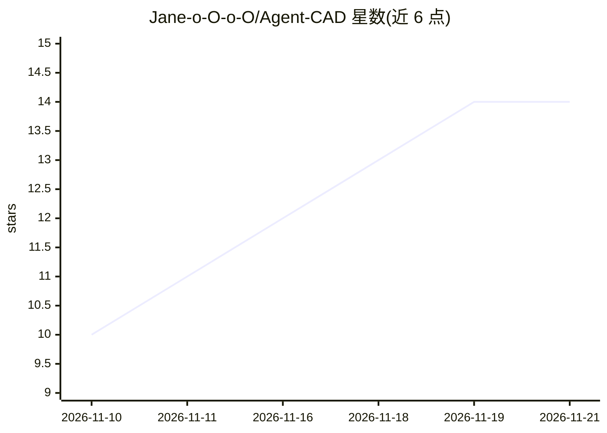

# Jane-o-O-o-O/Agent-CAD

⭐ 14 · Python · MIT · 推送 2026-10-21 · [GitHub](https://github.com/Jane-o-O-o-O/Agent-CAD) · 个人维护 · 中文 README

**把机械设计需求转成参数化3D实体与可编辑2D工程图的 AI CAD agent**

开源 AI CAD 应用：将机械设计需求转为参数化 3D 实体与可编辑 2D 图纸，基于 build123d/OpenCascade 做精确 B-Rep 建模，输出 STEP/STL/GLB/DXF/SVG/IR/replay Python 等七类工件并绑定同一版本。支持自然语言生成、对话式参数编辑、几何校验（STEP 回读）、装配与 BOM。提供独立 CAD 工作台与含 AgentScope 的完整应用两种运行模式；默认 strict worker 要求 Linux（Landlock ABI≥3、libseccomp2）。明确 DXF/SVG 不含通用 GD&T 与剖视图自动化，不支持原生 DWG。

## 筛选速览

| 维度 | 判定 | 备注 |
|---|---|---|
| AI 角色 | `ai-native` | 本体是模型或模型工具 |
| 许可风险 | `permissive` | MIT |
| 部署形态 | `self-host` | docker 或自建部署 |
| 模型依赖 | — | README 未给出锁定关系 |
| 硬件要求 | — | 无带数字的原话,不猜 |
| 安装摩擦 | `low` | 无编译、无系统依赖或容器化 |
| 成熟度 | — | 结构信号不足 |

## 能力要点

- 自然语言到 CAD IR 再到实体的生成流程，显式 IR 与支持的离线提示词无需模型 key
- 对话式原子补丁编辑，被拒绝的编辑保留最近有效版本
- 每次版本发布七类核心工件（STEP/STL/GLB/DXF/SVG/IR/Python）
- 浏览器 3D/2D 工作台与 SSE 进度、认证 API

## 适用场景

- 用中文提示词生成安装板、支架、法兰等参数化机械零件
- 对话式修改孔径、孔位等特征并保留历史版本
- 导出 DXF 工程图纸与 STEP/BOM 用于交换与下游处理

## 场景标签

 · 领域:工业设计/CAD 工具

## 证据(README 行号)

> L14: Agent-CAD is an open-source AI CAD application that turns mechanical design requirements into parametric 3D solids 
> L16: Agent-CAD combines text-to-CAD generation, conversational feature edits, a browser-based 3D/2D workbench, and trace
> L45: |Natural-language CAD generation|Converts supported explicit prompts or model-planned requirements into typed CAD I

## 星数曲线

2026-11-10 10 → 2026-11-21 14（+4）

---
*卡片 v1 · prompt 1.4 · 生成 2026-11-18 · 置信度 high · 依据 README sha `b39aae736302` · [字段定义](../../DATASET.md)*
