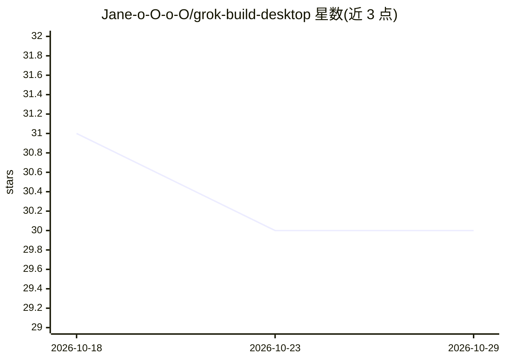

# Jane-o-O-o-O/grok-build-desktop

⭐ 30 · Rust · Apache-2.0 · 推送 2026-10-21 · [GitHub](https://github.com/Jane-o-O-o-O/grok-build-desktop) · [官网](https://github.com/Jane-o-O-o-O/grok-build-desktop/releases/latest) · 个人维护 · 中文 README

**xAI Grok Build / grok CLI 的开源 Electron 桌面客户端**

基于 Electron 的桌面 AI 编码工作台，包装原生 grok / Grok Build 运行时：通过 streaming-json 调用 CLI，共享 sessions、Memory、MCP、Skills 等配置与 ~/.grok/config.toml。支持并行 Agent 会话、多终端、内嵌浏览器、Git 集成、59 项原生设置、OpenAI/Anthropic 第三方模型发现与工具兼容桥。面向使用 Grok 编码 agent 的开发者；需先安装原生 grok CLI（桌面包不内置运行时）。提供 Windows/macOS/Linux 安装包，macOS 构建未签名。

## 筛选速览

| 维度 | 判定 | 备注 |
|---|---|---|
| AI 角色 | `ai-ecosystem` | LLM/agent 周边工具 |
| 许可风险 | `permissive` | Apache-2.0 |
| 部署形态 | `desktop` | 安装包/桌面程序 |
| 模型依赖 | locked-api |  |
| 硬件要求 | — | 无带数字的原话,不猜 |
| 安装摩擦 | `low` | 无编译、无系统依赖或容器化 |
| 成熟度 | `idea` | |

## 能力要点

- 以原生 grok CLI 为执行引擎，CLI/TUI/GUI 共享会话与配置
- 主 Agent + 侧 Agent 并行会话、多终端、内嵌浏览器、Git 集成
- OpenAI 兼容 / Anthropic 第三方模型发现与本地工具调用兼容桥
- 跨平台安装包（Windows Setup/Portable、macOS DMG、Linux AppImage/DEB）附 SHA-256

## 适用场景

- 为 grok CLI 编码 agent 提供图形化桌面工作台
- 在一个窗口内并行跑多个编码任务并查看工具执行过程
- 在 Grok Build 中接入 OpenAI 兼容或 Anthropic 第三方模型并保持工具调用

## 场景标签

`编码 Agent` · 领域:编码与开发

## 证据(README 行号)

> L47: - Every task runs through the local `grok` / Grok Build runtime
> L53: **One line:** keep the native Grok Build execution engine; get a desktop workflow for chat, tools, parallel tasks, 

## 星数曲线

2026-10-18 31 → 2026-10-29 30（-1）

---
*卡片 v1 · prompt 1.4 · 生成 2026-10-26 · 置信度 mid · 依据 README sha `108c83749d6c` · [字段定义](../../DATASET.md)*
