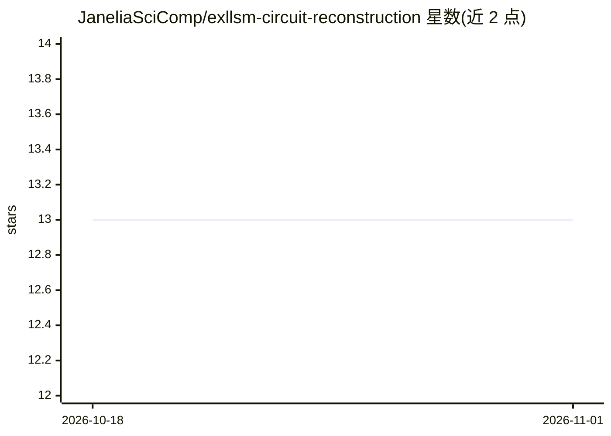

# JaneliaSciComp/exllsm-circuit-reconstruction

⭐ 13 · Nextflow · BSD-3-Clause · 推送 2026-10-28 · [GitHub](https://github.com/JaneliaSciComp/exllsm-circuit-reconstruction) · 组织维护

**ExLLSM 显微成像分析 Nextflow 流水线：拼接、分割与突触预测**

封装膨胀晶格光片显微镜（ExLLSM）图像分析工作流的 Nextflow 流水线，面向神经科学研究人员，包含分布式拼接（含平场校正与去卷积）、图像处理（文件转换、Fiji 裁剪、串扰扣除、阈值化）、神经元分割与突触位点预测与量化四类工作流，并集成 VVD Viewer。容器化交付，依赖 Nextflow（≥20.10.0）与 Singularity（≥3.5），已在独立 Linux 工作站与 Janelia LSF 集群测试，支持本地与集群分布式运行。

## 筛选速览

| 维度 | 判定 | 备注 |
|---|---|---|
| AI 角色 | `ai-native` | 本体是模型或模型工具 |
| 许可风险 | `permissive` | BSD-3-Clause |
| 部署形态 | `None` |  |
| 模型依赖 | — | README 未给出锁定关系 |
| 硬件要求 | — | 无带数字的原话,不猜 |
| 安装摩擦 | `low` | 无编译、无系统依赖或容器化 |
| 成熟度 | — | 结构信号不足 |

## 能力要点

- 四类工作流：拼接、图像处理、神经元分割、突触预测
- Nextflow 容器化，支持本地与 LSF 集群分布式运行
- 拼接流程含平场校正与去卷积
- 突触工作流检测并量化神经元内突触位点与连接

## 适用场景

- 处理膨胀光片显微镜神经元成像数据
- 在 HPC 集群上批量执行图像拼接与分割
- 量化神经元间的突触连接

## 场景标签

`图像视频处理` `目标检测` · 领域:感知与多模态

## 证据(README 行号)

> L45: * **Neuron Segmentation** - workflows for neuron segmentation
> L46: * **Synapse Prediction** - workflows to detect and quantify synaptic sites within and connections between neurons

## 星数曲线

2026-10-18 13 → 2026-11-01 13（+0）

---
*卡片 v1 · prompt 1.4 · 生成 2026-10-31 · 置信度 high · 依据 README sha `3cdb78ecf320` · [字段定义](../../DATASET.md)*
