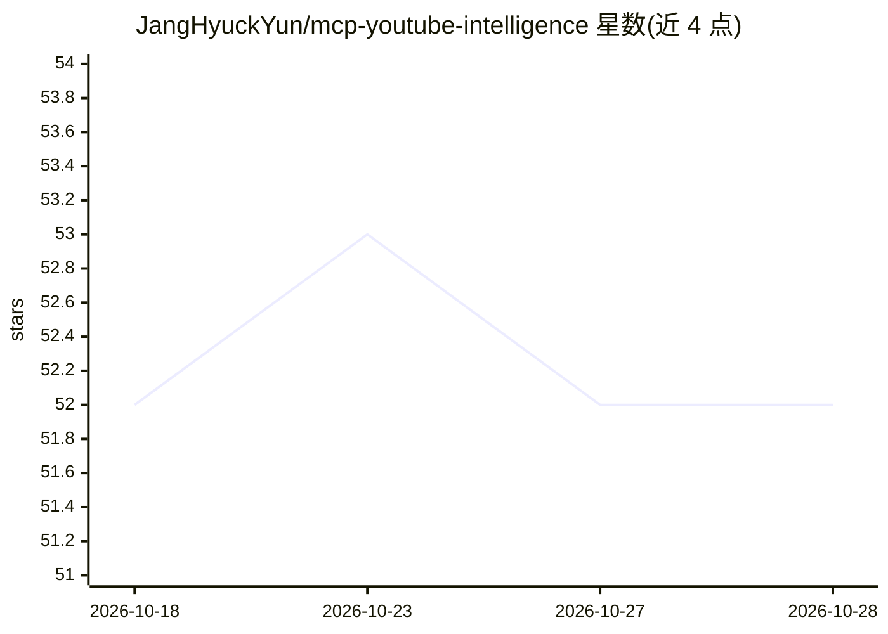

# JangHyuckYun/mcp-youtube-intelligence

⭐ 52 · Python · Apache-2.0 · 推送 2026-10-09 · [GitHub](https://github.com/JangHyuckYun/mcp-youtube-intelligence) · 个人维护 · 中文 README

**YouTube 转录提取与内容分析的 MCP 服务器 + CLI**

面向 Claude、Cursor 等 AI 工具的 MCP 服务器，通过 stdio 协议提供 9 个工具：视频元数据、字幕提取（summary/full/chunks 模式）、评论情感分析、实体抽取、主题分割、频道 RSS 监控、字幕与 YouTube 搜索、播放列表分析。核心机制是在服务器端处理原始字幕（2,000~30,000 token），向 LLM 只传递 200~500 token；字幕提取依赖 yt-dlp；无 LLM 时回退到抽取式摘要。支持 OpenAI/Anthropic/Google/Ollama/vLLM/LM Studio 作为摘要后端，缓存可用 SQLite 或 PostgreSQL。以 pip 包与 CLI 形式提供。

## 筛选速览

| 维度 | 判定 | 备注 |
|---|---|---|
| AI 角色 | `ai-ecosystem` | LLM/agent 周边工具 |
| 许可风险 | `permissive` | Apache-2.0 |
| 部署形态 | `library` | 以包/库形式分发 |
| 模型依赖 | local-ok | 支持本地模型 |
| 硬件要求 | — | 无带数字的原话,不猜 |
| 安装摩擦 | `low` | 无编译、无系统依赖或容器化 |
| 成熟度 | — | 结构信号不足 |

## 能力要点

- 9 个 MCP 工具：字幕提取、评论情感分析、实体抽取、主题分割、频道监控等
- 服务器端处理字幕，向 LLM 只传递约 200~500 token
- 多 LLM 后端可选：OpenAI/Anthropic/Google/Ollama/vLLM/LM Studio，无 LLM 时抽取式摘要兜底
- SQLite/PostgreSQL 缓存已提取字幕，支持全文检索

## 适用场景

- 在 Claude/Cursor 等客户端中用一句话分析 YouTube 视频
- 压缩长视频字幕后交给 LLM 做摘要，控制 token 消耗
- RSS 监控频道新视频并生成分析报告
- 搜索已缓存字幕与 YouTube 内容

## 场景标签

`网页抓取` `AI 写作` · 领域:效率与自动化

## 证据(README 行号)

> L10: > **YouTube 영상을 지능적으로 분석하는 MCP 서버 + CLI**
> L114: > MCP 서버는 **stdio** 프로토콜로 통신합니다.
> L139: |Tool|설명|예상 토큰|

## 星数曲线

2026-10-18 52 → 2026-10-28 52（+0）

---
*卡片 v1 · prompt 1.4 · 生成 2026-10-24 · 置信度 high · 依据 README sha `6562d29e28e7` · [字段定义](../../DATASET.md)*
