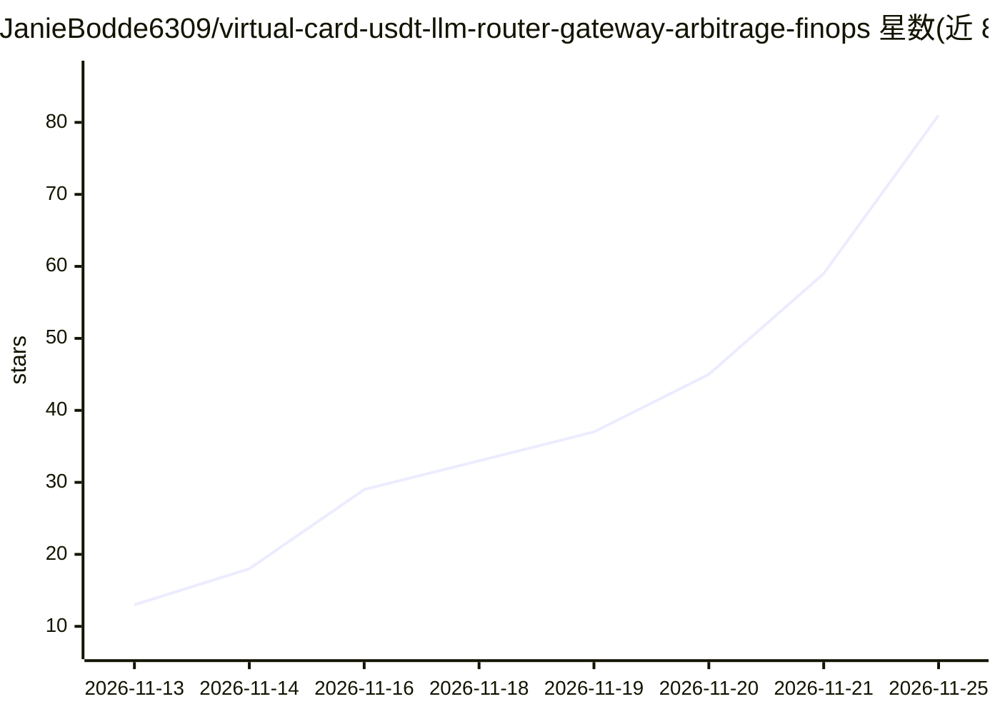

# JanieBodde6309/virtual-card-usdt-llm-router-gateway-arbitrage-finops

⭐ 81 · 推送 2026-11-13 · [GitHub](https://github.com/JanieBodde6309/virtual-card-usdt-llm-router-gateway-arbitrage-finops) · [官网](https://app.coregold.io/signup?invite_code=ADvlj9b) · 组织维护

**面向多路由 LLM 网关付费环节的虚拟卡架构指南（CoreGold 推广文档）**

一份架构与部署指南（无代码）：说明 OpenRouter / LiteLLM / Portkey 等多供应商 LLM 路由在 Auto-Topup 并发充值时可能触发银行风控锁卡与级联故障，并给出以 USDT 充值的 CoreGold 美国商业银行虚拟卡（VCC）+ Apple Pay 令牌化的解决方案：每条路由一张硬限额独立卡、US 地址 AVS 对齐、USDT 实时入金与一键销卡回款。文末引导注册 CoreGold 控制台，带推广性质。给搭建生产级多路由推理架构的工程/FinOps 团队参考。

## 筛选速览

| 维度 | 判定 | 备注 |
|---|---|---|
| AI 角色 | `ai-knowledge` | 知识聚合/清单类 |
| 许可风险 | `none` | — |
| 部署形态 | `None` |  |
| 模型依赖 | — | README 未给出锁定关系 |
| 硬件要求 | — | 无带数字的原话,不猜 |
| 安装摩擦 | `low` | 无编译、无系统依赖或容器化 |
| 成熟度 | — | 结构信号不足 |

## 能力要点

- 分析多网关并发微额充值触发发卡行风控锁卡的故障模式
- 每条上游路由配一张硬限额隔离 VCC 的清算层拓扑设计
- USDT (TRC20/ERC20) 入金、Apple Pay DPAN 令牌化与一键销卡回款流程
- 给出含具体 BIN 与卡命名规则的生产部署步骤

## 适用场景

- 多 LLM 网关生产架构的支付与成本故障预案参考
- 为 OpenRouter / DeepSeek 等账户配置隔离的充值支付工具
- 了解跨境微额充值触发银行风控的机制

## 场景标签

 · 领域:AI 基础设施运维/支付清算

## 证据(README 行号)

> L2: An architectural FinOps and payment-clearing guide for multi-provider LLM routers (OpenRouter / LiteLLM / Portkey) r
> L5: Modern production AI architectures rarely rely on a single inference endpoint. Engineering teams deploy unified rout
> L52: 👉 **Deploy Your USDT Virtual Card on CoreGold Console**

## 星数曲线

2026-11-13 13 → 2026-11-25 81（+68）

---
*卡片 v1 · prompt 1.4 · 生成 2026-11-18 · 置信度 mid · 依据 README sha `f7f6035e3455` · [字段定义](../../DATASET.md)*
