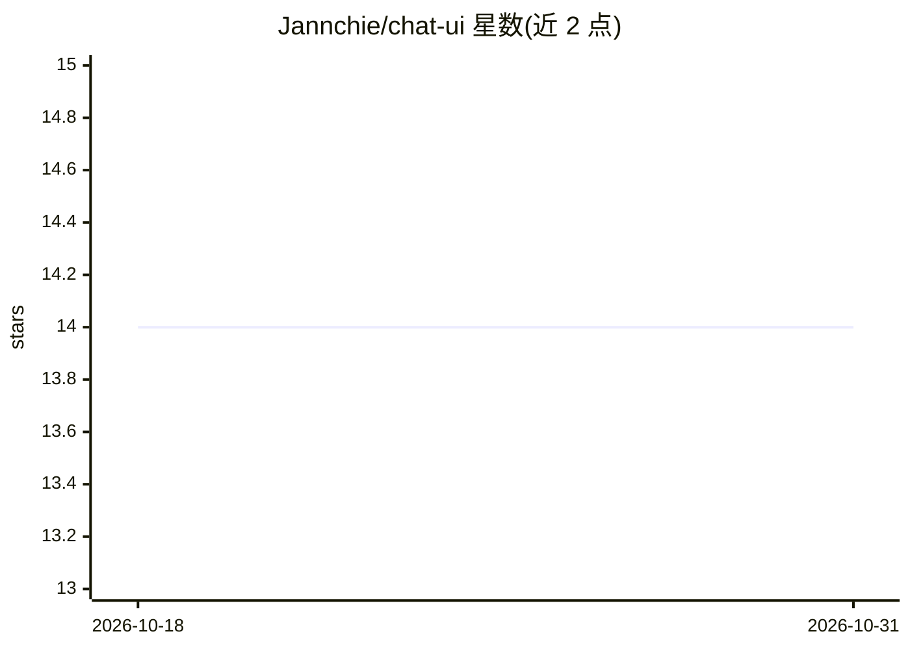

# Jannchie/chat-ui

⭐ 14 · Vue · 推送 2026-07-10 · [GitHub](https://github.com/Jannchie/chat-ui) · [官网](https://chat.jannchie.com) · 个人维护

**纯前端页面：通过网页访问多种 LLM API 聊天**

仅运行在浏览器端的前端页面，用于接入各类 LLM 服务：支持 ChatGPT API、Open Router API，并通过自定义模式兼容所有 OpenAI 兼容平台 API。用户在界面左上角选择模型、右上角填入 API Key 后即可对话。功能包括聊天历史、推理过程（Thinking）展示、数学公式渲染、代码块与 Markdown 复制、图片上传，UI 复刻 Gemini 风格。Gemini API 接入与消息编辑等仍在 TODO 列表。

## 筛选速览

| 维度 | 判定 | 备注 |
|---|---|---|
| AI 角色 | `ai-ecosystem` | LLM/agent 周边工具 |
| 许可风险 | `none` | — |
| 部署形态 | `None` |  |
| 模型依赖 | — | README 未给出锁定关系 |
| 硬件要求 | — | 无带数字的原话,不猜 |
| 安装摩擦 | `low` | 无编译、无系统依赖或容器化 |
| 成熟度 | — | 结构信号不足 |

## 能力要点

- 纯前端实现，无需自建后端
- 支持 ChatGPT API、Open Router API 及所有 OpenAI 兼容平台（自定义模式）
- 展示推理过程（Thinking）与聊天历史
- 数学公式渲染、代码块复制、图片上传

## 适用场景

- 用一个网页直接调用自己已有的 LLM API Key
- 在 OpenAI 兼容平台的自定义端点上聊天
- 查看模型推理过程与渲染公式、代码输出

## 场景标签

`聊天机器人` · 领域:对话与助手

## 证据(README 行号)

> L5: A generic frontend-only page for accessing various LLM APIs.
> L15: - [x] Support for ChatGPT API.

## 星数曲线

2026-10-18 14 → 2026-10-31 14（+0）

---
*卡片 v1 · prompt 1.4 · 生成 2026-10-31 · 置信度 high · 依据 README sha `c8906f0db954` · [字段定义](../../DATASET.md)*
