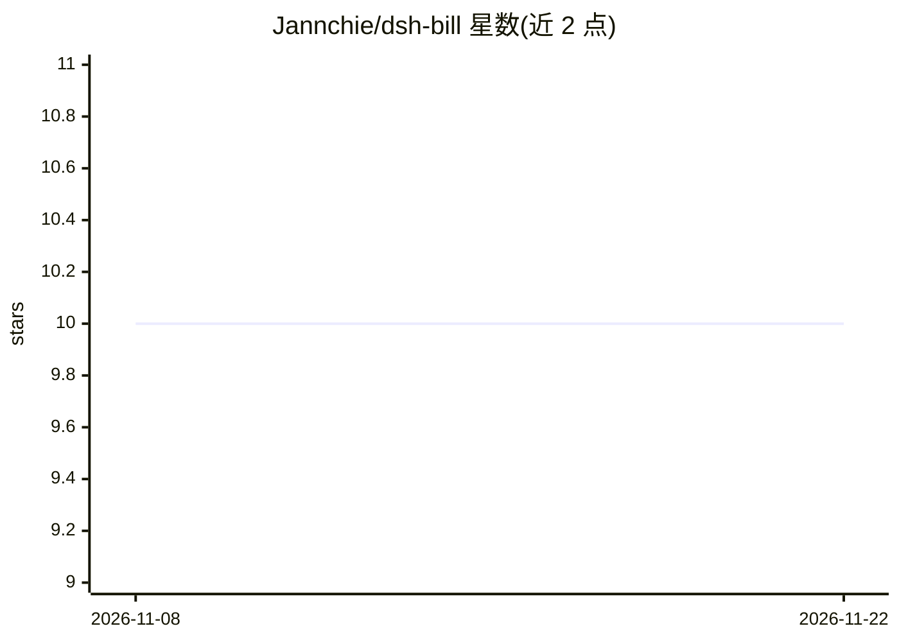

# Jannchie/dsh-bill

⭐ 10 · JavaScript · MIT · 推送 2026-10-23 · [GitHub](https://github.com/Jannchie/dsh-bill) · [官网](https://www.npmjs.com/package/dsh-bill) · 个人维护

**DSH 的成本追踪插件：逐轮费用与用途归因报告**

面向 DSH (DeepSeek Harness) 用户的插件：在每轮回复下方显示该轮费用、步数与缓存命中率，在会话 Cost 标签页与账户级 Cost 面板展示总计、token、缓存命中、余额与月度预测；将请求按时捕获切分为分类段（工具输出、模型输出、系统提示等），按缓存前缀位置分摊成本。通过 llm-pricing 拉取 models.dev 与 OpenRouter 目录定价（8000+ 条目，24h 缓存），逐调用时刻计价且不重算历史；支持预算阈值变色、~166 种货币实时汇率、安装前历史回填（不可回溯归因）与 bill_stats agent 工具。

## 筛选速览

| 维度 | 判定 | 备注 |
|---|---|---|
| AI 角色 | `ai-ecosystem` | LLM/agent 周边工具 |
| 许可风险 | `permissive` | MIT |
| 部署形态 | `None` |  |
| 模型依赖 | — | README 未给出锁定关系 |
| 硬件要求 | — | 无带数字的原话,不猜 |
| 安装摩擦 | `low` | 无编译、无系统依赖或容器化 |
| 成熟度 | — | 结构信号不足 |

## 能力要点

- 按内容类别（工具输出/模型输出/系统提示等）的费用归因，含旭日图下钻
- 经 llm-pricing 拉取 models.dev 与 OpenRouter 目录，覆盖 8000+ 模型条目
- 逐调用时刻计价，不重算历史；峰/谷费率按调用时间戳选取
- 安装前历史从会话日志回填为支出（无法回溯归因）

## 适用场景

- 查看每个会话与每轮对话分别花了多少钱
- 按月预算控制 API 支出，超 80% 时提示
- 分析费用花在哪类内容上（工具调用、模型输出等）
- 用 bill_stats 工具直接向模型询问近几日支出

## 场景标签

`LLM 可观测性` · 领域:评测与运维

## 证据(README 行号)

> L5: Cost tracking for DSH (DeepSeek Harness). A line under each turn tells you what that turn cost; the conversation's *
> L25: - **Cost attribution** — the bill split by kind of content: tool output, model output, system prompt, terminal comm

## 星数曲线

2026-11-08 10 → 2026-11-22 10（+0）

---
*卡片 v1 · prompt 1.4 · 生成 2026-11-20 · 置信度 high · 依据 README sha `68b578d78874` · [字段定义](../../DATASET.md)*
