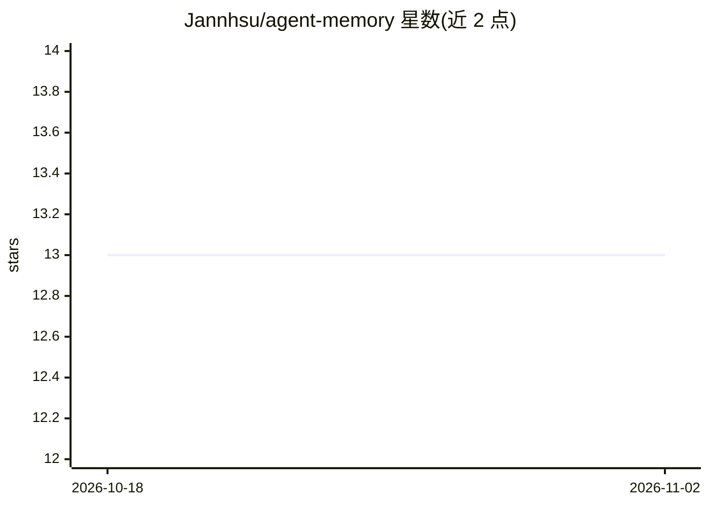

# Jannhsu/agent-memory

⭐ 13 · JavaScript · 推送 2026-03-20 · [GitHub](https://github.com/Jannhsu/agent-memory) · 个人维护

**面向 AI agent 的自动长期记忆插件：纯 markdown 无向量库**

为 OpenCode/Claude Code 等支持 markdown skill 系统的 AI agent 提供长期记忆：后台插件在每轮对话时用 Gemini Flash 抽取事实写入 staging，会话边界时分类合并进 Identity/Knowledge/Preferences/Lessons 四类 SKILL.md，附 Recent 滑窗摘要与日期分区原始日志。agent 只读不写，检索依赖 frontmatter 描述而非向量检索。安装为复制 skills/plugins 目录并设置 GEMINI_API_KEY；Claude Code 需自行将 memory.js 改写为 SessionEnd hook（插件钩子不原生支持）。

## 筛选速览

| 维度 | 判定 | 备注 |
|---|---|---|
| AI 角色 | `ai-ecosystem` | LLM/agent 周边工具 |
| 许可风险 | `none` | — |
| 部署形态 | `None` |  |
| 模型依赖 | — | README 未给出锁定关系 |
| 硬件要求 | — | 无带数字的原话,不猜 |
| 安装摩擦 | `low` | 无编译、无系统依赖或容器化 |
| 成熟度 | — | 结构信号不足 |

## 能力要点

- 插件负责全部写入（抽取/分类/去重/矛盾消解），agent 只读取
- 四类记忆 skill 文件 + Recent 滑窗摘要 + reference 日期分区日志
- 无向量库、无嵌入，靠 skill frontmatter 描述做检索
- staging 即读即清、锁超时恢复等并发安全机制

## 适用场景

- 让我的 OpenCode agent 跨会话记住个人偏好与业务知识
- Claude Code 用户通过改造 hook 获得自动记忆能力
- 不想部署向量数据库的个人助手记忆方案

## 场景标签

`Agent 记忆` · 领域:Agent 开发

## 证据(README 行号)

> L3: Agent reads, plugin writes. Fully automatic long-term memory for AI agents. No database. No embeddings. No agent par
> L15: A plugin hook fires on every conversation turn. It calls a lightweight LLM (Gemini Flash) to extract facts from the
> L114: The skill files work with any agent that supports markdown with YAML frontmatter — including OpenCode, Claude Code

## 星数曲线

2026-10-18 13 → 2026-11-02 13（+0）

---
*卡片 v1 · prompt 1.4 · 生成 2026-10-31 · 置信度 high · 依据 README sha `ec55e63f79e7` · [字段定义](../../DATASET.md)*
