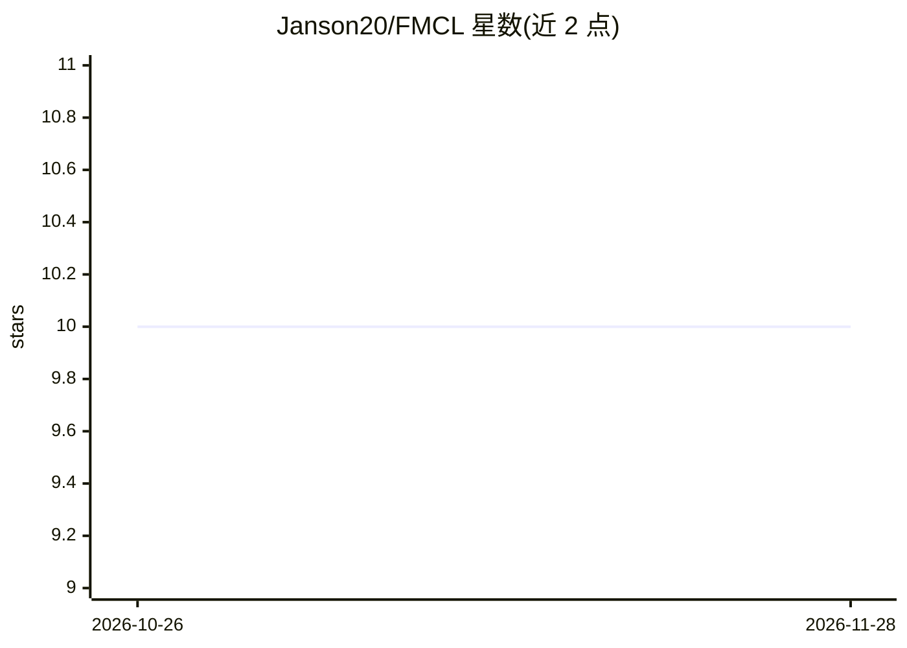

# Janson20/FMCL

⭐ 10 · Python · GPL-3.0 · 推送 2026-11-19 · [GitHub](https://github.com/Janson20/FMCL) · [官网](https://fmcl-web.xn--44qp25ma834f.org/) · 个人维护 · 中文 README

**带 AI Agent 助手与离线语音输入的 Minecraft 启动器**

基于 Qt Quick（PySide6/QML）的 Minecraft 启动器，功能覆盖版本管理、8 种模组加载器安装、BMCLAPI 国内镜像加速、Modrinth/CurseForge 资源浏览、整合包管理与开服、EasyTier P2P 联机、存档备份、音乐播放与成就系统。AI 部分：多提供商模型的 Agent 助手（33 个工具、三级权限、流式对话）、SenseVoice 离线语音输入、异常退出时的 AI 崩溃诊断。Windows 提供安装包，Linux 提供 tarball 或脚本源码构建，macOS 仅源码运行。

## 筛选速览

| 维度 | 判定 | 备注 |
|---|---|---|
| AI 角色 | `ai-enhanced` | 去掉 AI 部分产品仍成立 |
| 许可风险 | `viral` | GPL-3.0 |
| 部署形态 | `desktop` | 安装包/桌面程序 |
| 模型依赖 | — | README 未给出锁定关系 |
| 硬件要求 | — | 无带数字的原话,不猜 |
| 安装摩擦 | `high` | 编译与系统依赖俱全 |
| 成熟度 | — | 结构信号不足 |

## 能力要点

- Agent 助手：多提供商模型、33 个可调用工具、三级权限与流式对话
- SenseVoice 离线语音输入
- 8 种模组加载器安装、9 种识别，BMCLAPI 镜像加速
- EasyTier P2P 联机与服务器一键开服

## 适用场景

- 一站式管理 Minecraft 版本、模组、整合包与服务器
- 通过对话让 AI 助手代为操作启动器功能
- 国内网络环境下加速游戏资源下载
- 启动失败时用 AI 诊断崩溃原因

## 场景标签

`AI 助手` · 领域:对话与助手

## 证据(README 行号)

> L9: 一个基于 **Qt Quick（QML，PySide6）** 的 Minecraft 启动器，覆盖版本管理、模组生态、开服、联机、备份、音乐、成就与 AI 助手。界面使用 QML 构建，命令行模式保留在 `main.py`。
> L21: - **AGENT 与语音**：多提供商模型、33 个工具、三级权限、Skills 与流式对话；SenseVoice 离线语音输入。

## 星数曲线

2026-10-26 10 → 2026-11-28 10（+0）

---
*卡片 v1 · prompt 1.4 · 生成 2026-11-20 · 置信度 high · 依据 README sha `6f878369b174` · [字段定义](../../DATASET.md)*
