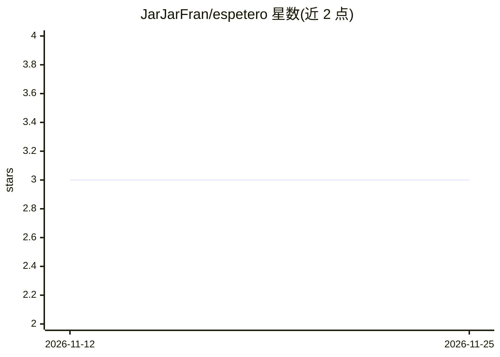

# JarJarFran/espetero

⭐ 3 · C++ · MIT · 推送 2026-11-20 · [GitHub](https://github.com/JarJarFran/espetero) · 个人维护

**Apple 芯片上的本地 LLM 推理服务器，兼容 OpenAI/Anthropic/Ollama API**

面向 Apple silicon 的原生 Metal 推理引擎（C++20 与 Metal，无 Python），提供本地 HTTP 服务器与内置聊天界面；模型经 Hugging Face 仓库 ID 或本地 MLX 目录/GGUF 文件加载。兼容 OpenAI、Anthropic 与 Ollama 客户端接口，可指向 Claude Code。自带 EQ 量化格式与无 Python 的量化命令；支持 MTP 投机解码、MoE 专家 SSD 卸载与图像输入。安装提供 Homebrew（源码构建，需 Xcode CLT）或 make 源码编译。README 以 M1 Max 与 M4 Max 上的基准表对比多款引擎。

## 筛选速览

| 维度 | 判定 | 备注 |
|---|---|---|
| AI 角色 | `ai-ecosystem` | LLM/agent 周边工具 |
| 许可风险 | `permissive` | MIT |
| 部署形态 | `None` |  |
| 模型依赖 | local-ok | 支持本地模型 |
| 硬件要求 | — | 无带数字的原话,不猜 |
| 安装摩擦 | `medium` | 含编译或系统依赖之一 |
| 成熟度 | — | 结构信号不足 |

## 能力要点

- 原生 Metal 引擎（C++20，无 Python），单次 GPU pass 处理聊天/图像/分类
- 兼容 OpenAI、Anthropic、Ollama 客户端 API，内置 Web 聊天界面
- 自研 EQ 量化格式（3-8 bit）与 `espetero quantize` 无 Python 量化
- 支持 MTP 投机解码与 MoE 专家 SSD 卸载（64GB Mac 运行 106GB 模型）

## 适用场景

- 在 Mac 上本地运行开源 LLM 并接入现有 OpenAI/Anthropic 客户端
- 让 Claude Code 指向本地模型服务（ANTHROPIC_BASE_URL）
- 将 Hugging Face BF16 检查点量化为 EQ 格式在 Apple 芯片推理
- 多用户并发本地推理服务（16 并行槽位）

## 场景标签

`推理引擎` `模型量化` · 领域:训练与推理

## 证据(README 行号)

> L3: **Fast LLM inference for Apple silicon.** A native Metal engine (C++20 and Metal, no Python) that puts every request
> L15: Then open `http://127.0.0.1:8080` for the built-in chat, or point any OpenAI, Anthropic or Ollama client at it (Cla

## 星数曲线

2026-11-12 3 → 2026-11-25 3（+0）

---
*卡片 v1 · prompt 1.4 · 生成 2026-11-22 · 置信度 high · 依据 README sha `ed75930ccaf2` · [字段定义](../../DATASET.md)*
