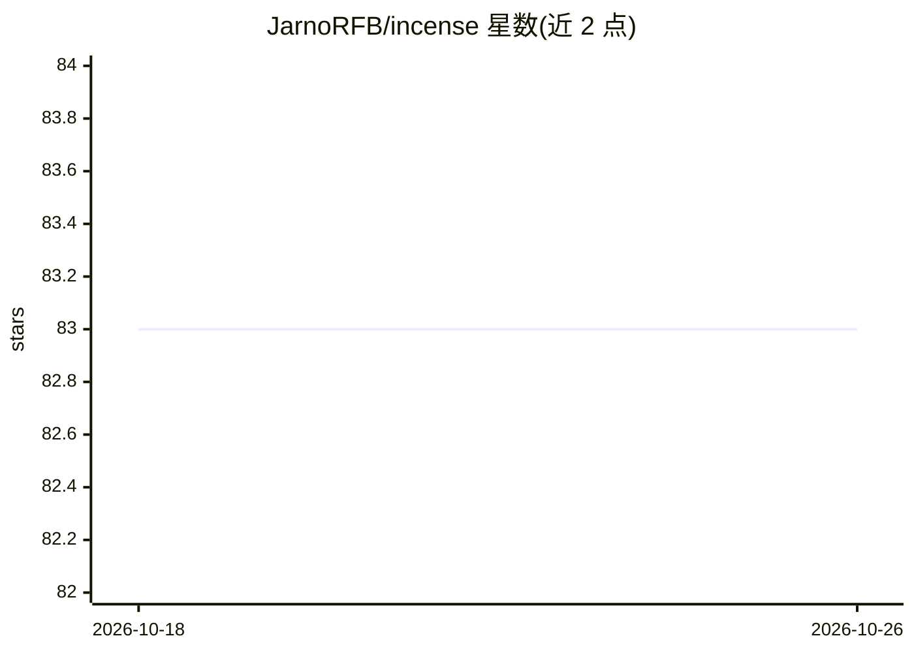

# JarnoRFB/incense

⭐ 83 · Python · MIT · 推送 2026-02-04 · [GitHub](https://github.com/JarnoRFB/incense) · 个人维护

**供科研者在 Jupyter 中检索与解读 sacred 实验记录的 Python 工具库**

面向使用 sacred 框架记录机器学习实验的用户，Incense 从 sacred 存实验的 MongoDB 数据库中按 id、名称或超参数值查询实验，在 Jupyter notebook 内展示配置、工件（artifacts）与指标。工件按类型渲染：PNG 显示为图片，CSV 转为 pandas DataFrame；指标默认转为 pandas Series 以便绘图。通过 pip 安装，提供 demo.ipynb 与 Binder 在线试用；开发环境可使用 VSCode devcontainer（自动装依赖并启动 MongoDB 与 JupyterLab）或 conda。注意：README 未给出对 sacred 实验数据库之外的实验框架支持。

## 筛选速览

| 维度 | 判定 | 备注 |
|---|---|---|
| AI 角色 | `ai-ecosystem` | LLM/agent 周边工具 |
| 许可风险 | `permissive` | MIT |
| 部署形态 | `library` | 以包/库形式分发 |
| 模型依赖 | — | README 未给出锁定关系 |
| 硬件要求 | — | 无带数字的原话,不猜 |
| 安装摩擦 | `low` | 无编译、无系统依赖或容器化 |
| 成熟度 | — | 结构信号不足 |

## 能力要点

- 按 id、名称、超参数值查询 sacred 实验
- 工件按类型渲染（PNG→图片、CSV→DataFrame）
- 指标转为 pandas Series 便于绘图
- 提供 demo.ipynb 与 Binder 在线交互试用

## 适用场景

- 在 Jupyter 中查看和分析 sacred 记录的实验结果
- 按超参数筛选并对比多次实验的配置与指标
- 将实验工件（图片、CSV）直接嵌入分析流程

## 场景标签

`科研工具` · 领域:学习与行业

## 证据(README 行号)

> L20: to facilitate manual interpretation of experiments that are logged using
> L21: `sacred <https://github.com/IDSIA/sacred>`__. It lets you find and
> L28: transformed into ``pandas Series``, which allows for flexible plotting.

## 星数曲线

2026-10-18 83 → 2026-10-26 83（+0）

---
*卡片 v1 · prompt 1.4 · 生成 2026-10-24 · 置信度 high · 依据 README sha `db4179910913` · [字段定义](../../DATASET.md)*
