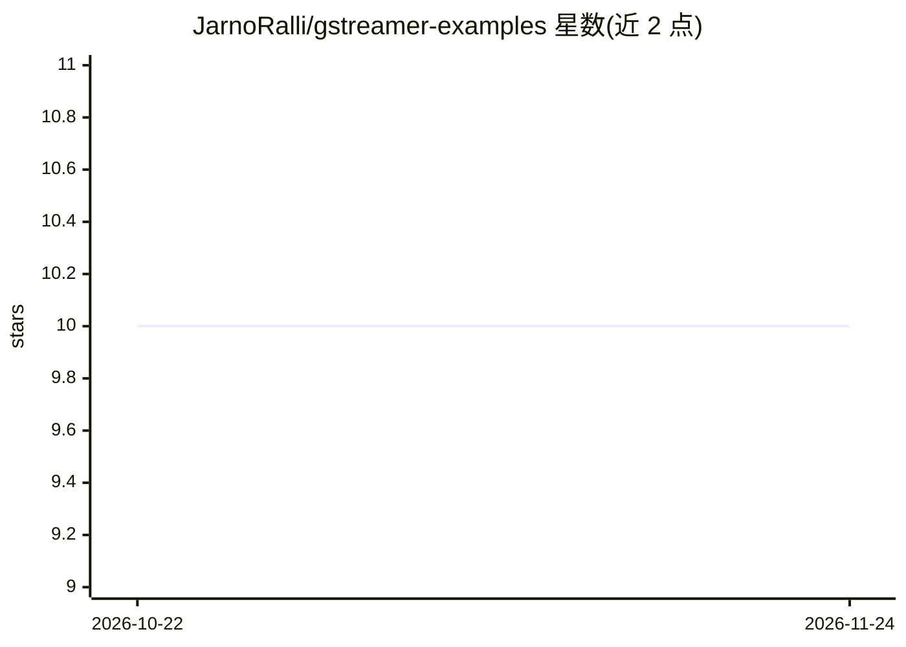

# JarnoRalli/gstreamer-examples

⭐ 10 · C++ · BSD-3-Clause · 推送 2026-08-15 · [GitHub](https://github.com/JarnoRalli/gstreamer-examples) · 个人维护

**给多媒体/推理开发者的 GStreamer 与 DeepStream 管线示例集**

收录 GStreamer、DeepStream 与 Hailo 相关示例的仓库，示例以 Python 与 C/C++ 编写，目录包括 helper 工具包、deepstream-examples、hailo-examples、gst-examples、docker 与 conda 环境。helper 包提供创建 gst-pipelines 的辅助函数，通过 build 构建为 wheel 后用 pip 安装。docker 目录包含容器文件及面向 GStreamer 1.28 的 MCP 服务器，为编码 Agent 提供对应版本文档访问，以避免 LLM 因上下文限制无法阅读 GStreamer 源码。

## 筛选速览

| 维度 | 判定 | 备注 |
|---|---|---|
| AI 角色 | `ai-ecosystem` | LLM/agent 周边工具 |
| 许可风险 | `permissive` | BSD-3-Clause |
| 部署形态 | `library` | 以包/库形式分发 |
| 模型依赖 | — | README 未给出锁定关系 |
| 硬件要求 | — | 无带数字的原话,不猜 |
| 安装摩擦 | `low` | 无编译、无系统依赖或容器化 |
| 成熟度 | — | 结构信号不足 |

## 能力要点

- GStreamer/DeepStream/Hailo 三类示例，Python 与 C/C++ 编写
- helper-package 提供创建 gst-pipelines 的辅助函数与类
- docker 目录含容器文件与 GStreamer 1.28 文档的 MCP 服务器
- 提供 conda 虚拟环境配置

## 适用场景

- 学习用 GStreamer/DeepStream 搭建图像处理管线
- 在 Hailo 设备上运行推理示例
- 让编码 Agent 查询特定版本的 GStreamer 文档

## 场景标签

`教程课程` · 领域:学习与行业

## 证据(README 行号)

> L5: This repository contains examples related to GStreamer, Deepstream and Hailo. Some of the examples are written in Py
> L22:  * Model Context Protocol (MCP) for GStreamer 1.28
> L77: media framework in existence, so even LLMs with large context windows might be thrown off if they need to start ana

## 星数曲线

2026-10-22 10 → 2026-11-24 10（+0）

---
*卡片 v1 · prompt 1.4 · 生成 2026-11-20 · 置信度 mid · 依据 README sha `925565ca4992` · [字段定义](../../DATASET.md)*
