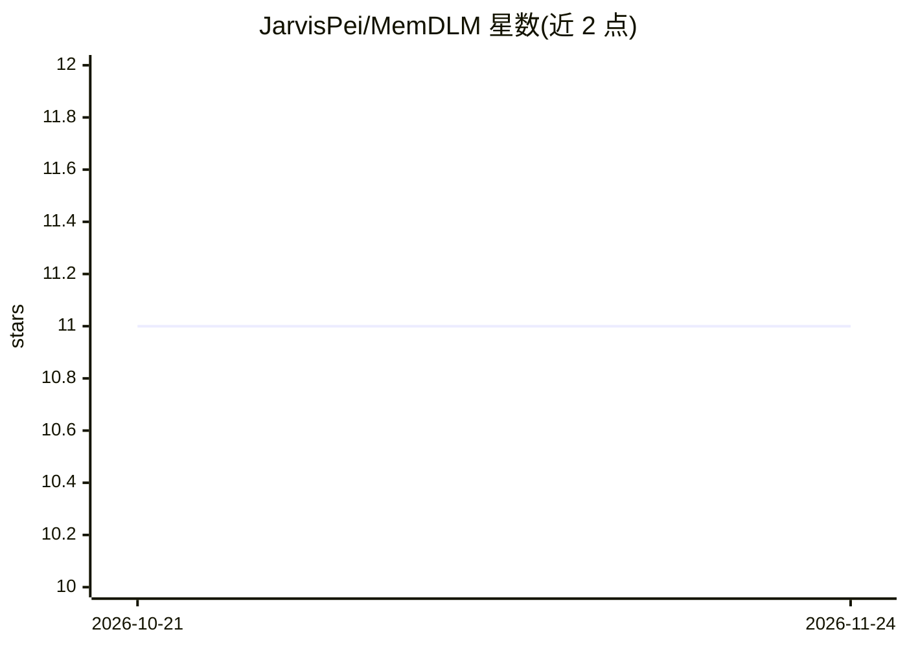

# JarvisPei/MemDLM

⭐ 11 · Python · MIT · 推送 2026-04-08 · [GitHub](https://github.com/JarvisPei/MemDLM) · 个人维护

**给扩散语言模型加参数化记忆的训练研究代码库**

MemDLM 通过双层优化弥合扩散语言模型的训练-推理差距：内循环写入捕捉局部去噪轨迹经验的快权重（LoRA 形式的参数化记忆），外循环据此更新基座模型；推理时可重新启用内循环做 prompt 特定适配。提供 conda 环境安装、数据预处理脚本、LLaDA 系列基座的训练与评测脚本（BABILong/RULER/LongBench），并发布两个已训练的 HuggingFace 适配器。依赖 dLLM 框架（git 子模块），训练支持单卡 4bit 量化+LoRA 测试路径及 DDP/FSDP 同步。

## 筛选速览

| 维度 | 判定 | 备注 |
|---|---|---|
| AI 角色 | `ai-native` | 本体是模型或模型工具 |
| 许可风险 | `permissive` | MIT |
| 部署形态 | `library` | 以包/库形式分发 |
| 模型依赖 | — | README 未给出锁定关系 |
| 硬件要求 | — | 无带数字的原话,不猜 |
| 安装摩擦 | `low` | 无编译、无系统依赖或容器化 |
| 成熟度 | — | 结构信号不足 |

## 能力要点

- 内循环快权重+外循环更新的双层优化训练机制
- 推理时启用参数化记忆做 prompt 特定适配
- 发布 LLaDA-MoE-7B-A1B 与 LLaDA2.1-mini 两个适配器
- 19 个 mem_* 超参数可配置（内循环步数/LoRA 秩/损失类型等）

## 适用场景

- 在 LLaDA 系扩散语言模型上复现参数化记忆训练实验
- 对长上下文理解基准（BABILong/RULER/LongBench）做带记忆的推理评测
- 基于 dLLM 框架扩展扩散语言模型训练方法研究

## 场景标签

`微调` `模型训练` `模型评测` · 领域:评测与运维

## 证据(README 行号)

> L9: **MemDLM** bridges the train-inference gap in Diffusion Language Models via Bi-level Optimization.
> L44: MemDLM training extends standard MDLM SFT with `--mem_enabled True` and related hyperparameters.

## 星数曲线

2026-10-21 11 → 2026-11-24 11（+0）

---
*卡片 v1 · prompt 1.4 · 生成 2026-11-19 · 置信度 high · 依据 README sha `c37ca2fb2dda` · [字段定义](../../DATASET.md)*
