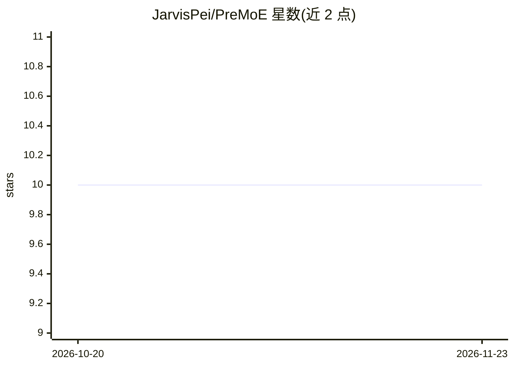

# JarvisPei/PreMoE

⭐ 10 · Python · MIT · 推送 2026-07-23 · [GitHub](https://github.com/JarvisPei/PreMoE) · [官网](https://arxiv.org/abs/2505.17639) · 组织维护

**给 MoE 大模型做免训练稀疏化以降低推理开销的框架**

官方实现 PreMoE：免训练的 MoE 推理优化框架，基于小规模校准集从路由 logits 计算 Predicted Expert Utility 分数，生成领域感知的专家排序，编译出领域专用或通用的高稀疏 MoE 变体，声称最高 50% 稀疏度。以 vLLM 补丁形式应用，三阶段流水线（常规推理、logit 收集与打分、剪枝推理），支持 DeepSeek-R1、openPangu-Ultra-MoE、Qwen3-30B-A3B，可部署于 CUDA GPU 与华为 Ascend NPU，MIT 许可，配套论文被 COLM 2026 接收。

## 筛选速览

| 维度 | 判定 | 备注 |
|---|---|---|
| AI 角色 | `ai-ecosystem` | LLM/agent 周边工具 |
| 许可风险 | `permissive` | MIT |
| 部署形态 | `library` | 以包/库形式分发 |
| 模型依赖 | local-ok | 支持本地模型 |
| 硬件要求 | — | 无带数字的原话,不猜 |
| 安装摩擦 | `medium` | 含编译或系统依赖之一 |
| 成熟度 | — | 结构信号不足 |

## 能力要点

- 免训练：仅用 5-10 条校准样本计算 PEU 专家重要性分数
- 三阶段流水线：常规推理→logit 收集打分→按专家排序剪枝推理
- 通过 vLLM 补丁运行，支持 CUDA GPU 与 Ascend NPU
- 覆盖 30B 至 718B 参数的 MoE 模型（DeepSeek-R1/Qwen3 等）

## 适用场景

- 把 DeepSeek-R1 等大 MoE 模型在自有领域数据上剪枝成轻量专家版本
- 在 GPU 或昇腾 NPU 上降低 MoE 推理时的激活专家数量
- 按数学/代码/对话等校准数据定制模型稀疏策略

## 场景标签

`推理引擎` `模型量化` · 领域:训练与推理

## 证据(README 行号)

> L14: PreMoE is a **training-free** framework that proactively compiles sparse MoE variants for targeted deployment scena
> L74: - vLLM == 0.13.0
> L90: PreMoE supports both **CUDA GPU** and **Ascend NPU** deployments.

## 星数曲线

2026-10-20 10 → 2026-11-23 10（+0）

---
*卡片 v1 · prompt 1.4 · 生成 2026-11-20 · 置信度 high · 依据 README sha `ebbe58a4d427` · [字段定义](../../DATASET.md)*
