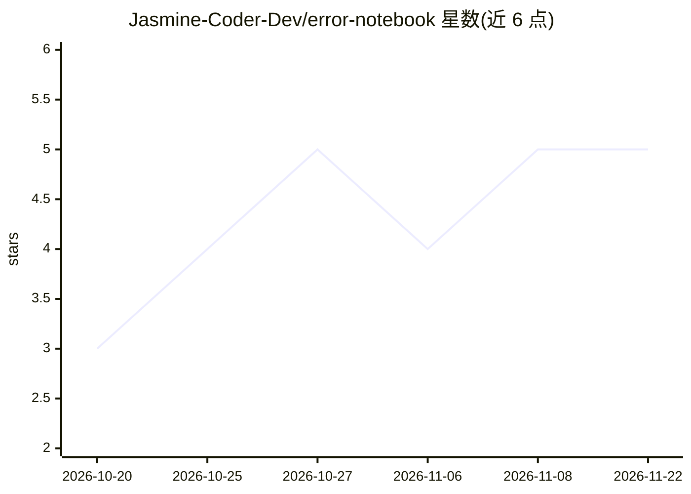

# Jasmine-Coder-Dev/error-notebook

⭐ 5 · Rust · MIT · 推送 2026-10-12 · [GitHub](https://github.com/Jasmine-Coder-Dev/error-notebook) · 个人维护 · 中文 README

**给家长/学生的本地错题本：试卷切题+AI打标+组卷**

基于 Tauri 2（Rust 后端 + 原生前端）的桌面错题管理应用：上传 PDF/Word/图片试卷后自动切题并校对，支持 AI 知识点打标、答案解析生成、同类题生成，配合 SM-2 间隔复习、模考模式、薄弱优先组卷与系统打印，并提供题型/知识点统计图表与旭日图知识图谱。数据存于本地 SQLite，无账号无云端；AI 功能可选自配厂商 API Key，也可选 Mock 模式离线体验。提供 macOS（Apple 芯片）与 Windows x64 安装包，安装包 4~6MB。

## 筛选速览

| 维度 | 判定 | 备注 |
|---|---|---|
| AI 角色 | `ai-native` | 本体是模型或模型工具 |
| 许可风险 | `permissive` | MIT |
| 部署形态 | `desktop` | 安装包/桌面程序 |
| 模型依赖 | locked-api |  |
| 硬件要求 | — | 无带数字的原话,不猜 |
| 安装摩擦 | `low` | 无编译、无系统依赖或容器化 |
| 成熟度 | — | 结构信号不足 |

## 能力要点

- PDF/Word 试卷自动切题，兼容多种中文题号格式并支持 AI 整卷校对
- AI 三能力：知识点打标、答案解析、同类题生成，支持 GLM/DeepSeek/Kimi/MiniMax/Qwen
- SM-2 间隔重复复习与薄弱优先条件抽题组卷、一键打印
- 数据 100% 本地 SQLite 存储，无账号/无遥测/无云端，JSON 导入导出迁移

## 适用场景

- 把孩子考试的试卷 PDF 一键整理成错题本
- 按薄弱知识点自动生成同类变式题组卷打印
- 用间隔重复计划每天安排错题复习
- 离线无账号管理错题，数据留在本机

## 场景标签

`文档解析` · 领域:知识与检索

## 证据(README 行号)

> L5: **本地优先的智能错题管理工具 —— 试卷秒变错题本，AI 找出薄弱点，一键组卷打印**
> L60: |🤖 AI 知识点自动打标|✅|从知识点目录约束选取，口径统一；支持 GLM/DeepSeek/Kimi/MiniMax/Qwen|
> L83: |💾 本地 SQLite 存储|✅|`~/.cuotiji/cuotiji.db`，复制即备份；跨版本自动迁移零破坏|

## 星数曲线

2026-10-20 3 → 2026-11-22 5（+2）

---
*卡片 v1 · prompt 1.4 · 生成 2026-11-21 · 置信度 high · 依据 README sha `cec9cabb08bf` · [字段定义](../../DATASET.md)*
