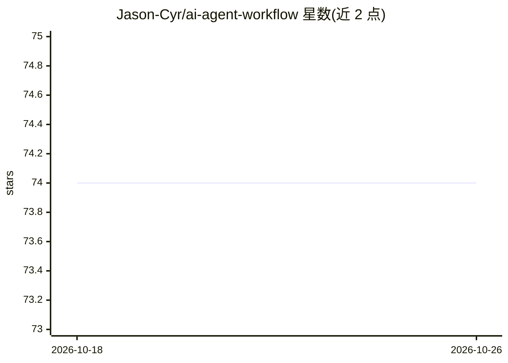

# Jason-Cyr/ai-agent-workflow

⭐ 74 · MIT · 推送 2026-03-30 · [GitHub](https://github.com/Jason-Cyr/ai-agent-workflow) · 个人维护

**Obsidian+Linear+OpenClaw 的持久 AI 队友搭建指南与模板**

一份作者日常使用的 AI agent 工作流搭建教程，附模板文件（AGENTS.md/SOUL.md/USER.md/PROJECT_CONTEXT.md 等）。方案将 Obsidian 作为共享知识库、Linear 做任务管理、Slack 等即时通讯渠道做实时沟通，通过 OpenClaw agent 平台（npm 安装）连接三者，配置 Claude/OpenAI/Gemini 等 API key 驱动。agent 可读写 Obsidian 仓库、领取 Linear 任务、主动签到。内容以图文步骤为主，非可运行软件；主要成本为模型 API 费用。

## 筛选速览

| 维度 | 判定 | 备注 |
|---|---|---|
| AI 角色 | `ai-knowledge` | 知识聚合/清单类 |
| 许可风险 | `permissive` | MIT |
| 部署形态 | `library` | 以包/库形式分发 |
| 模型依赖 | — | README 未给出锁定关系 |
| 硬件要求 | — | 无带数字的原话,不猜 |
| 安装摩擦 | `low` | 无编译、无系统依赖或容器化 |
| 成熟度 | — | 结构信号不足 |

## 能力要点

- 四层架构：Obsidian 知识库 + Linear 任务 + 通讯渠道 + OpenClaw agent
- 提供 7 个模板文件（AGENTS.md、SOUL.md、MEMORY.md 等）
- 定义 Triple-Update 规则与记忆约定（daily notes / MEMORY.md / PROJECT_CONTEXT.md）
- 支持 Slack、Discord、Telegram、WhatsApp 等多通讯渠道

## 适用场景

- 搭建有持久记忆的个人 AI agent 工作流
- 让 agent 以团队成员身份领取和流转 Linear 任务
- 通过即时通讯渠道与 agent 日常协作并获得主动汇报

## 场景标签

`教程课程` `Agent 记忆` · 领域:Agent 开发

## 证据(README 行号)

> L13: This system fixes that by connecting three tools through a persistent AI agent:
> L17: |🧠 **Brain**|Obsidian|Shared knowledge base — notes, projects, daily journals|
> L238: All templates are in the `templates/` directory:
> L242: |`AGENTS.md`|Standing instructions for your agent|

## 星数曲线

2026-10-18 74 → 2026-10-26 74（+0）

---
*卡片 v1 · prompt 1.4 · 生成 2026-10-24 · 置信度 mid · 依据 README sha `a197e9c26949` · [字段定义](../../DATASET.md)*
