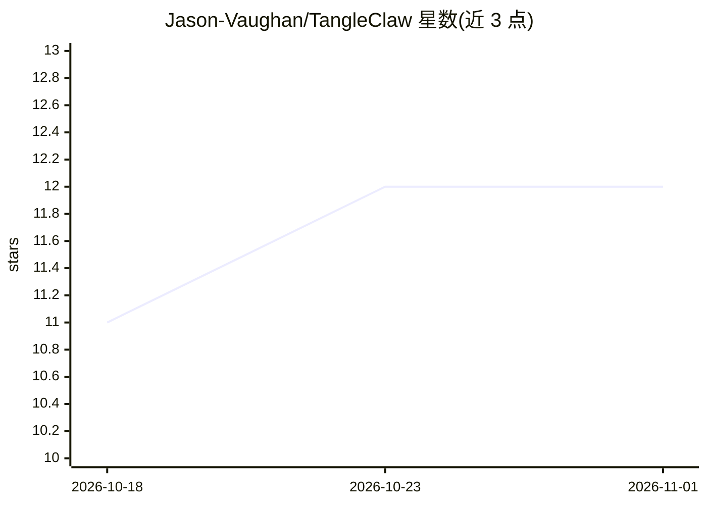

# Jason-Vaughan/TangleClaw

⭐ 12 · JavaScript · MIT · 推送 2026-10-31 · [GitHub](https://github.com/Jason-Vaughan/TangleClaw) · [官网](https://tangle-claw.vercel.app) · 个人维护

**本地优先的 AI 编码 agent 编排平台：多引擎会话管理与协作**

运行在用户 Mac 上的小型 Node.js 22 服务器（零 npm 依赖），本地启动并监管多个 AI 编码 agent 会话（Claude Code、Codex、Antigravity、Aider，及远程 OpenClaw），提供 tmux 持久会话、结构化会话收尾摘要、会话间消息交换（Medusa）、项目规则统一注入、跨项目端口注册、仪表盘与手机 PWA。规则一次编写即生成各引擎原生配置；AI 可提议规则修改但需人工批准。仅支持 macOS（依赖 launchd）。

## 筛选速览

| 维度 | 判定 | 备注 |
|---|---|---|
| AI 角色 | `ai-ecosystem` | LLM/agent 周边工具 |
| 许可风险 | `permissive` | MIT |
| 部署形态 | `library` | 以包/库形式分发 |
| 模型依赖 | — | README 未给出锁定关系 |
| 硬件要求 | — | 无带数字的原话,不猜 |
| 安装摩擦 | `low` | 无编译、无系统依赖或容器化 |
| 成熟度 | — | 结构信号不足 |

## 能力要点

- tmux 持久会话与结构化 wrap（摘要、changelog、续接 brief）
- 一次编写规则即生成各引擎原生配置，覆盖 4 个本地引擎与远程 OpenClaw
- 会话间直接消息（Medusa）带送达台账与未答阻塞升级
- Node.js 22 标准库实现，零 npm 依赖，无构建步骤

## 适用场景

- 同时运行多个 AI 编码 agent 时避免冲突、保留上下文跨会话续接
- 从浏览器或手机监管和操控本机的 agent 会话
- 多项目环境下统一端口分配与跨项目共享文档

## 场景标签

`编码 Agent` `多智能体` `Agent 框架` · 领域:Agent 开发

## 证据(README 行号)

> L18: TangleClaw is the layer above the agents that deals with that. It runs on your own Mac, starts and supervises each 
> L34: - Not a model, and not a new coding agent. It runs the agents you already use.
> L35: - Not a cloud service. It is a small server on your machine, written against Node.js 22's standard library: no `npm

## 星数曲线

2026-10-18 11 → 2026-11-01 12（+1）

---
*卡片 v1 · prompt 1.4 · 生成 2026-11-01 · 置信度 mid · 依据 README sha `81b9eb77f929` · [字段定义](../../DATASET.md)*
