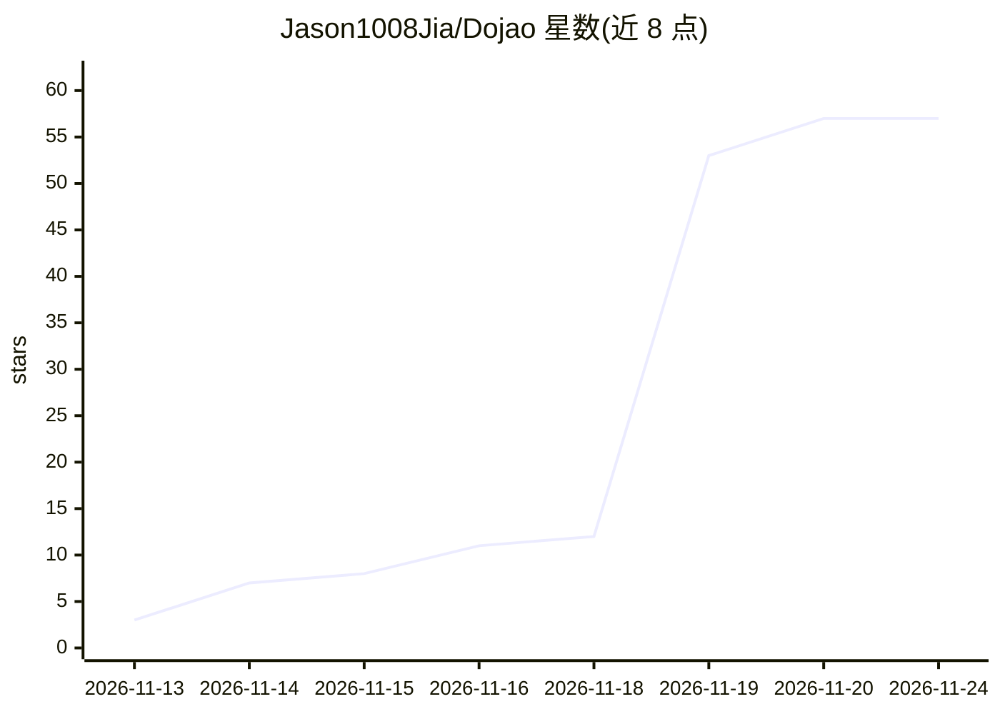

# Jason1008Jia/Dojao

⭐ 57 · Java · Apache-2.0 · 推送 2026-11-22 · [GitHub](https://github.com/Jason1008Jia/Dojao) · 个人维护

**给数据分析师/科学家的跨源分布式 SQL 计算引擎，带 AI 问数 Agent**

Java 实现的分布式 MPP 计算引擎：一条 SQL 跨 MySQL/TiDB/Doris/PostgreSQL/SQL Server/Oracle/Hive/ClickHouse/Excel 做联邦查询，不搬迁数据；Python UDF 经 Arrow Flight sidecar 进程注册为 SQL 函数；窗口/排序/Join 算子支持减量式磁盘溢写；内置流式 ReAct Agent 用自然语言生成并执行 SQL、渲染图表，工具按角色授权且 DDL 需人工确认。发行包解压即用，可单进程或组多机集群，配 Web 控制台、CLI 与 JDBC 驱动。

## 筛选速览

| 维度 | 判定 | 备注 |
|---|---|---|
| AI 角色 | `ai-enhanced` | 去掉 AI 部分产品仍成立 |
| 许可风险 | `permissive` | Apache-2.0 |
| 部署形态 | `None` |  |
| 模型依赖 | — | README 未给出锁定关系 |
| 硬件要求 | — | 无带数字的原话,不猜 |
| 安装摩擦 | `medium` | 含编译或系统依赖之一 |
| 成熟度 | — | 结构信号不足 |

## 能力要点

- 一条 SQL 跨 9 类数据源联邦查询，三段名 catalog.schema.table
- Python UDF/UDAF 经 Arrow Flight 零拷贝执行，协议语言中立
- GroupBy/Window/SortMergeJoin/HashJoin 共享减量式溢写管线
- 内置 ReAct Agent：13 个工具、11 种图表渲染、DDL 人工确认

## 适用场景

- 把散落在多个数据库和 Excel 里的数据用一条 SQL 联合分析
- 把 Python 统计量或小模型注册成 SQL 函数直接在查询里调用
- 用自然语言让 Agent 跨源取数并生成可视化图表
- 内存不足场景下跑大表 Join 并观测溢写过程

## 场景标签

`数据分析` · 领域:效率与自动化

## 证据(README 行号)

> L12: Dojao 不是一个数据库，也不只是一个查询引擎。它是一个**面向数据科学家和分析师的分布式计算引擎**：
> L31: 5. **AI 原生集成** —— 内置流式 ReAct Agent：一条自然语言完成跨源取数、SQL 执行与图表展示；
> L32:  工具按角色授权，DDL 执行前必须人工确认。

## 星数曲线

2026-11-13 3 → 2026-11-24 57（+54）

---
*卡片 v1 · prompt 1.4 · 生成 2026-11-18 · 置信度 high · 依据 README sha `4ad762438d98` · [字段定义](../../DATASET.md)*
