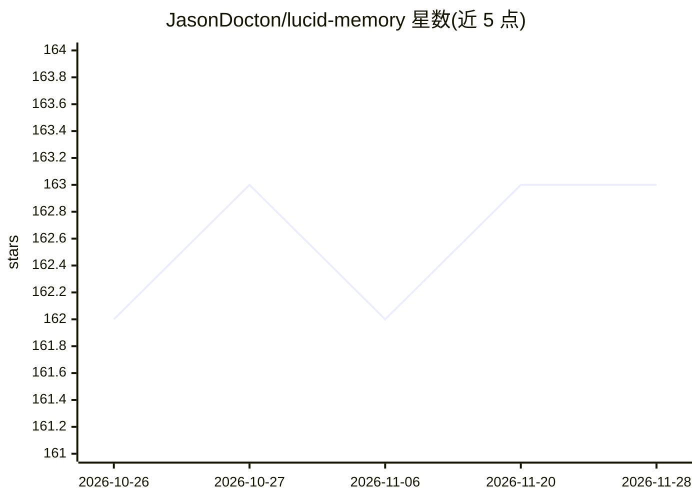

# JasonDocton/lucid-memory

⭐ 163 · TypeScript · GPL-3.0 · 推送 2026-11-04 · [GitHub](https://github.com/JasonDocton/lucid-memory) · 个人维护

**为 AI 编码助手提供本地、持久、即时检索的跨会话记忆层**

以 MCP 服务器形式为 Claude Code、OpenAI Codex、OpenCode 提供 AI 记忆层：自动捕获用户提示与助手回复，存储为本地 gist 压缩记忆，通过 MINERVA 2 语义立方、乘性新近度加权与 3 跳扩散激活做检索，支持情景记忆与后台记忆整合。Rust 核心 + Bun 运行时，默认 BGE 本地嵌入，可换 Ollama/OpenAI 端点，数据库支持共享/按客户端/自定义 profile。要求 5GB 磁盘与至少一个受支持客户端。

## 筛选速览

| 维度 | 判定 | 备注 |
|---|---|---|
| AI 角色 | `ai-ecosystem` | LLM/agent 周边工具 |
| 许可风险 | `viral` | GPL-3.0 |
| 部署形态 | `None` |  |
| 模型依赖 | local-ok | 支持本地模型 |
| 硬件要求 | — | 无带数字的原话,不猜 |
| 安装摩擦 | `low` | 无编译、无系统依赖或容器化 |
| 成熟度 | — | 结构信号不足 |

## 能力要点

- 本地记忆检索（README 称 2.7ms，743,000 条/秒吞吐）
- 多客户端支持：Claude Code、Codex、OpenCode，MCP + hook 自动捕获
-  gist 压缩、乘性新近度、扩散激活等检索机制
- 本地/远程嵌入端点可配置，含 Ollama 兼容接口

## 适用场景

- 让 Claude Code 记住跨会话的调试与重构上下文
- 为多个 AI 编码客户端配置共享或隔离的记忆数据库
- 用本地嵌入端点避免文本发送到云端

## 场景标签

`Agent 记忆` · 领域:Agent 开发

## 证据(README 行号)

> L11:  Works with Claude Code, OpenAI Codex & OpenCode · macOS & Linux · Windows instructions
> L189: 6. Configures MCP settings for your chosen clients
> L197: To use a model served by Ollama or another OpenAI-compatible server, set the following variables in the environmen

## 星数曲线

2026-10-26 162 → 2026-11-28 163（+1）

---
*卡片 v1 · prompt 1.4 · 生成 2026-11-27 · 置信度 high · 依据 README sha `4002542add1a` · [字段定义](../../DATASET.md)*
