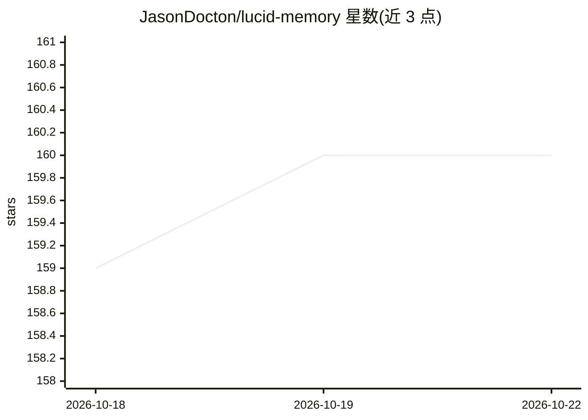

# JasonDocton/lucid-memory

⭐ 160 · TypeScript · GPL-3.0 · 推送 2026-02-20 · [GitHub](https://github.com/JasonDocton/lucid-memory) · 个人维护

**本地持久化记忆层：让 Claude Code 等 AI 编程助手跨会话记忆**

面向 Claude Code、OpenAI Codex、OpenCode 等 AI 编程客户端的本地记忆层：通过 MCP 配置接入客户端，自动捕获会话记忆并在后续检索注入。机制包括 gist 压缩（约 37 token/条）、MINERVA 2 认知排序、乘法式新近度、3 跳扩散激活、情景记忆（时间序列链接）与后台记忆巩固（衰减/剪枝）；支持图像/视频的视觉记忆。Rust 核心，全部本地运行，安装脚本自动装 Bun 运行时与 BGE 嵌入模型（或用 OpenAI API）。需要 5GB 磁盘与至少一个受支持客户端，macOS/Linux/Windows 可装。

## 筛选速览

| 维度 | 判定 | 备注 |
|---|---|---|
| AI 角色 | `ai-ecosystem` | LLM/agent 周边工具 |
| 许可风险 | `viral` | GPL-3.0 |
| 部署形态 | `None` |  |
| 模型依赖 | locked-api |  |
| 硬件要求 | — | 无带数字的原话,不猜 |
| 安装摩擦 | `low` | 无编译、无系统依赖或容器化 |
| 成熟度 | — | 结构信号不足 |

## 能力要点

- MCP 接入 Claude Code / Codex / OpenCode，支持多客户端与数据库隔离
- 认知式检索：MINERVA 2 排序、乘法新近度、3 跳扩散激活
- 情景记忆：事件按时间序列链接，支持 before/after 叙事查询
- 视觉记忆：图像/视频自动处理、转写并按同一模型检索

## 适用场景

- 让我的 AI 编程助手记住之前会话修过的 bug 和上下文
- 重建调试会话的时间线，回答'我做 X 之前在做什么'
- 多客户端共享或隔离记忆数据库（工作/个人分档）

## 场景标签

`Agent 记忆` · 领域:Agent 开发

## 证据(README 行号)

> L11:  Works with Claude Code, OpenAI Codex & OpenCode · macOS & Linux · Windows instructions
> L189: 6. Configures MCP settings for your chosen clients
> L197: Lucid Memory supports Claude Code, OpenAI Codex, and OpenCode. During installation, you can choose any combination

## 星数曲线

2026-10-18 159 → 2026-10-22 160（+1）

---
*卡片 v1 · prompt 1.4 · 生成 2026-10-22 · 置信度 high · 依据 README sha `ec90ed2d80dd` · [字段定义](../../DATASET.md)*
