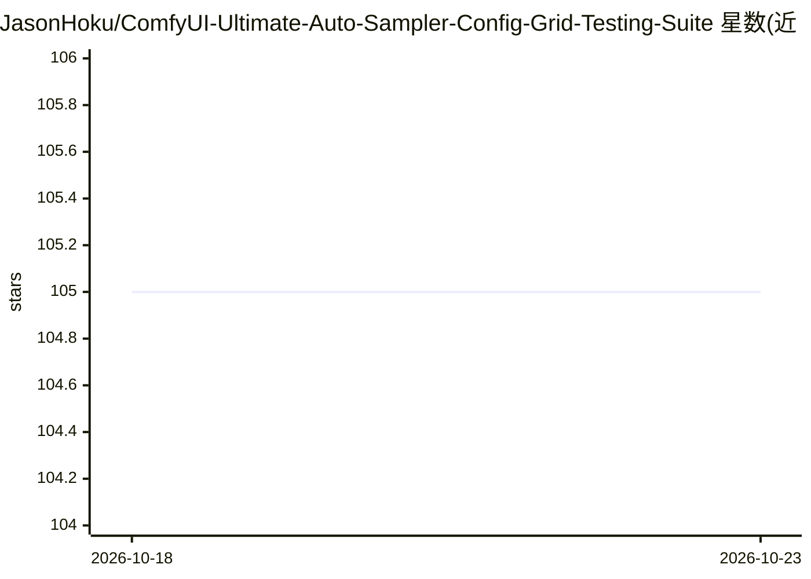

# JasonHoku/ComfyUI-Ultimate-Auto-Sampler-Config-Grid-Testing-Suite

⭐ 105 · JavaScript · 推送 2026-07-19 · [GitHub](https://github.com/JasonHoku/ComfyUI-Ultimate-Auto-Sampler-Config-Grid-Testing-Suite) · 个人维护

**给 ComfyUI 用户的采样器/模型/LoRA 参数网格基准测试套件**

ComfyUI 自定义节点套件，含三个节点：Config Builder（可视化构建配置）、Sampler Grid（笛卡尔积批量生成器）、Grid Dashboard（无限画布结果查看器）。对采样器、调度器、CFG、去噪值、提示词、模型、LoRA、VAE 等参数做全组合网格测试，支持 SD3/Flux 等非标准架构、多机分布式、智能缓存与断点续跑、放大后处理与 Florence2 局部修复。通过 Comfy Manager 安装，需在 ComfyUI 内接线使用；Florence2 修复功能需额外安装 ComfyUI-Florence2 节点。

## 筛选速览

| 维度 | 判定 | 备注 |
|---|---|---|
| AI 角色 | `ai-ecosystem` | LLM/agent 周边工具 |
| 许可风险 | `none` | — |
| 部署形态 | `None` |  |
| 模型依赖 | — | README 未给出锁定关系 |
| 硬件要求 | `gpu-8g` | |
| 安装摩擦 | `low` | 无编译、无系统依赖或容器化 |
| 成熟度 | — | 结构信号不足 |

## 能力要点

- 笛卡尔积引擎一次生成全部参数组合（采样器/调度器/CFG/提示词/模型/LoRA/VAE）
- 无限画布仪表盘支持虚拟滚动，可展示数千张图片
- 多机分布式：主节点分发任务、模型同步、断线重排队
- 智能缓存与停后续跑：跳过已生成图片

## 适用场景

- 批量对比不同采样器、调度器与 CFG 值的出图效果
- 一次跑多个 checkpoint 或整个模型文件夹选模型
- 测试 LoRA 组合与触发词对出图的影响

## 场景标签

`模型评测` · 领域:评测与运维

## 证据(README 行号)

> L11: Stop guessing which Sampler, Scheduler, Prompt, Denoise, Model, Lora or CFG value works best. This custom node suit
> L31: |2|**Ultimate Sampler Grid**|The generator — **required**|

## 星数曲线

2026-10-18 105 → 2026-10-23 105（+0）

---
*卡片 v1 · prompt 1.4 · 生成 2026-10-23 · 置信度 high · 依据 README sha `270f55e2111f` · [字段定义](../../DATASET.md)*
