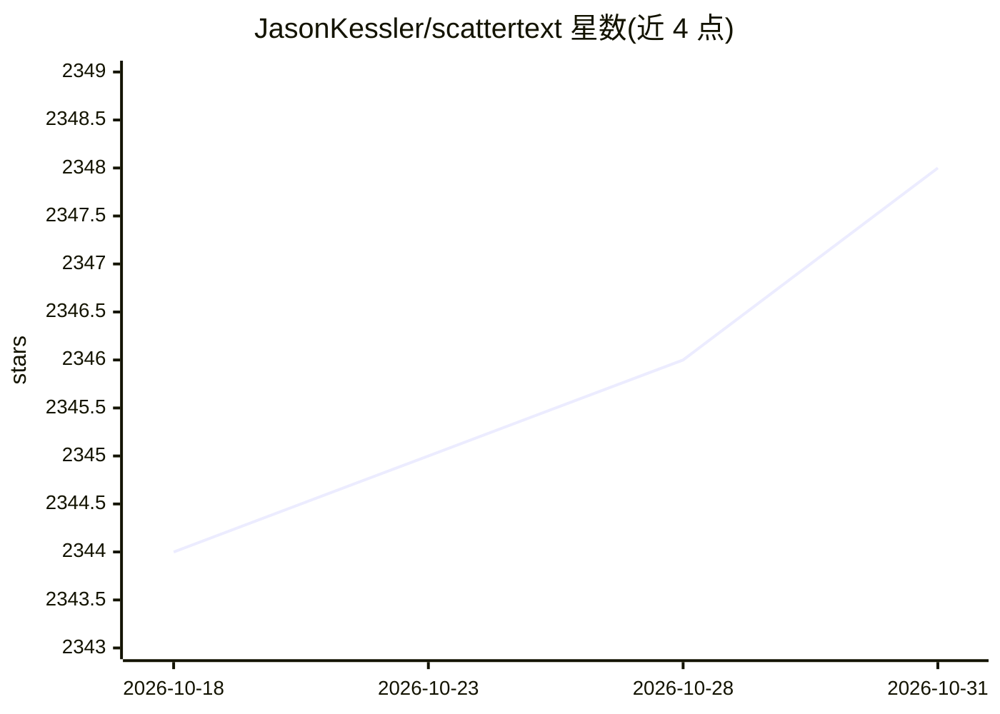

# JasonKessler/scattertext

⭐ 2,348 · Python · Apache-2.0 · 推送 2026-07-04 · [GitHub](https://github.com/JasonKessler/scattertext) · 个人维护

**对比不同类别文档用词差异并生成交互式散点图的 Python NLP 库**

Scattertext 是一个 Python 文本分析库：读取 Pandas 数据框中的文本与类别列，构建 Corpus，计算各类别下的特征词（含 Scaled F-Score 等词重要度公式）、多种离散度指标（Rosengren's S、Juilland's D 等），并输出可缩放拖拽的交互式 HTML 散点图，自动避让标签。分词默认配合 spaCy，也提供不依赖 spaCy 的 WhitespaceNLP 路径（功能受限）。同时提供命令行工具从 CSV 直接生成可视化。要求 Python 3.11+。

## 筛选速览

| 维度 | 判定 | 备注 |
|---|---|---|
| AI 角色 | `ai-native` | 本体是模型或模型工具 |
| 许可风险 | `permissive` | Apache-2.0 |
| 部署形态 | `library` | 以包/库形式分发 |
| 模型依赖 | — | README 未给出锁定关系 |
| 硬件要求 | — | 无带数字的原话,不猜 |
| 安装摩擦 | `low` | 无编译、无系统依赖或容器化 |
| 成熟度 | — | 结构信号不足 |

## 能力要点

- 按类别找出区分性词汇并计算 Scaled F-Score 关联分数
- 生成交互式 HTML 散点图（缩放/拖拽/标签避让）
- 提供 Dispersion 类含 Rosengren's S、Juilland's D 等多种离散度指标
- 附 CLI：从 CSV 文件直接产出可视化

## 适用场景

- 比较两党演讲、两类评论等不同类别语料的用词差异
- 探索性文本分析中识别各类别特征词
- 学术文本分析中可视化词频与离散度关系
- 不想写代码时用命令行快速生成对比散点图

## 场景标签

`数据分析` · 领域:效率与自动化

## 证据(README 行号)

> L8: A tool for finding distinguishing terms in corpora and displaying them in an
> L115: The library covers some novel and effective term-importance formulas, including **Scaled F-Score**.
> L324: >>> html = st.produce_scattertext_explorer(corpus,

## 星数曲线

2026-10-18 2,344 → 2026-10-31 2,348（+4）

---
*卡片 v1 · prompt 1.4 · 生成 2026-10-21 · 置信度 high · 依据 README sha `6c0bd560649d` · [字段定义](../../DATASET.md)*
