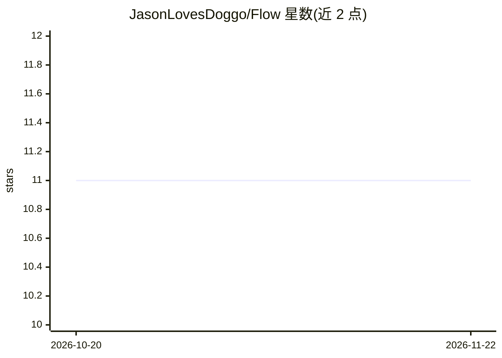

# JasonLovesDoggo/Flow

⭐ 11 · Rust · MIT · 推送 2026-02-18 · [GitHub](https://github.com/JasonLovesDoggo/Flow) · [官网](https://gowithflow.tech) · 个人维护

**macOS 原生语音听写工具：按住按键说话，输出格式化文本**

macOS 原生听写应用：按住 Fn 键说话，松开后文本插入光标处，音频经转录并格式化为干净文本。提供本地 Whisper 离线转录（Metal 加速），也可使用 OpenAI key 的云端路径。支持按应用切换语气（邮件正式、消息随意、代码友好）、按联系人自适应、语音快捷短语，并记住用户的改词修正。核心用 Rust 实现，Swift 做原生界面，C FFI 桥接。需 macOS 14+。

## 筛选速览

| 维度 | 判定 | 备注 |
|---|---|---|
| AI 角色 | `ai-native` | 本体是模型或模型工具 |
| 许可风险 | `permissive` | MIT |
| 部署形态 | `None` |  |
| 模型依赖 | — | README 未给出锁定关系 |
| 硬件要求 | — | 无带数字的原话,不猜 |
| 安装摩擦 | `medium` | 含编译或系统依赖之一 |
| 成熟度 | — | 结构信号不足 |

## 能力要点

- 本地 Whisper 离线转录，Metal 加速，无需 API
- 按应用/联系人自适应语气
- 记住用户改词，语音快捷短语
- Rust 核心 + Swift 原生界面

## 适用场景

- 在任意 macOS 应用中用语音替代键盘输入
- 写邮件/消息时自动匹配不同语气
- 离线环境下的本地语音转文字

## 场景标签

`语音识别` · 领域:感知与多模态

## 证据(README 行号)

> L2:  Voice dictation that actually learns. Free and open source.
> L14: - **Local Whisper** - fully offline, no API needed (Metal-accelerated)
> L34: Rust core (`flow-core/`) handles audio, transcription, learning, shortcuts, and storage. Swift wraps it for the nat

## 星数曲线

2026-10-20 11 → 2026-11-22 11（+0）

---
*卡片 v1 · prompt 1.4 · 生成 2026-11-19 · 置信度 high · 依据 README sha `1081097dc6db` · [字段定义](../../DATASET.md)*
