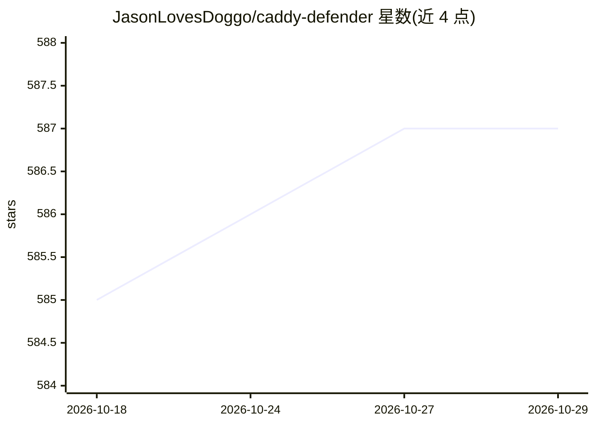

# JasonLovesDoggo/caddy-defender

⭐ 587 · Go · MIT · 推送 2026-10-25 · [GitHub](https://github.com/JasonLovesDoggo/caddy-defender) · [官网](http://defender.jsn.cam/) · 个人维护

**Caddy 中间件：按 IP 段拦截或污染 AI 爬虫请求**

基于 Caddy 的 HTTP 中间件，按客户端 IP 段（CIDR）对请求做拦截或改写，内置 OpenAI、DeepSeek、GitHub Copilot、AWS、Azure、GCP 等主流 AI 服务与云厂商的预定义 IP 段，也可在 Caddyfile 中自定义。提供 7 种响应后端：403 封禁、自定义消息、断开连接、返回垃圾数据污染 AI 训练、308 重定向、限速（需搭配 caddy-ratelimit）与慢速流式 tarpit。以预构建 Docker 镜像或 Caddy 插件形式提供给运维与站长使用。

## 筛选速览

| 维度 | 判定 | 备注 |
|---|---|---|
| AI 角色 | `ai-enhanced` | 去掉 AI 部分产品仍成立 |
| 许可风险 | `permissive` | MIT |
| 部署形态 | `self-host` | docker 或自建部署 |
| 模型依赖 | — | README 未给出锁定关系 |
| 硬件要求 | — | 无带数字的原话,不猜 |
| 安装摩擦 | `low` | 无编译、无系统依赖或容器化 |
| 成熟度 | — | 结构信号不足 |

## 能力要点

- 内置 17 组 AI 服务/云厂商预定义 IP 段，默认启用 aws/azure/gcloud/deepseek/githubcopilot/openai
- 7 种响应后端：block/custom/drop/garbage/redirect/ratelimit/tarpit
- garbage 与 tarpit 后端可向爬虫返回垃圾数据以污染 AI 训练
- 提供预构建 Docker 镜像，Caddyfile 单指令配置

## 适用场景

- 阻止 AI 爬虫抓取我的网站内容
- 向训练爬虫返回垃圾数据污染其数据集
- 对特定云厂商 IP 段做限速或重定向

## 场景标签

`网络安全` · 领域:学习与行业

## 证据(README 行号)

> L3: The **Caddy Defender** plugin is a middleware for Caddy that allows you to block or manipulate requests based on the
> L8: - **Embedded IP Ranges**: Predefined IP ranges for popular AI services (e.g., OpenAI, DeepSeek, GitHub Copilot).

## 星数曲线

2026-10-18 585 → 2026-10-29 587（+2）

---
*卡片 v1 · prompt 1.4 · 生成 2026-10-21 · 置信度 mid · 依据 README sha `60aecb9379d1` · [字段定义](../../DATASET.md)*
