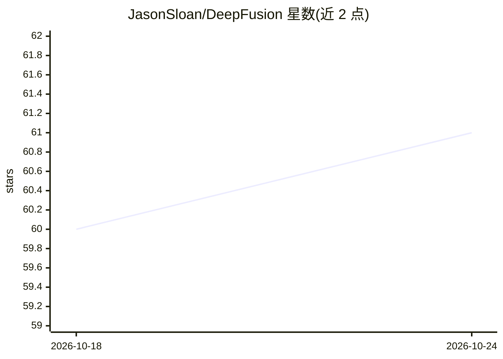

# JasonSloan/DeepFusion

⭐ 61 · C++ · 推送 2026-08-10 · [GitHub](https://github.com/JasonSloan/DeepFusion) · 个人维护 · 中文 README

**深度学习与强化学习算法代码、笔记与推理优化集合**

个人维护的深度学习综合仓库：包含理论笔记、CV/NLP/RL 代码、关键算法（Canny、ResNet、CBAM、SGBM 等）复现，以及面向 NVIDIA、Intel、RK 等多平台的推理代码与模型剪枝量化实践（含 YOLOv8/YOLOv11 剪枝原创工作）。另收录 PyTorch、Docker、FFmpeg、Linux、Git 等工程工具用法与面试题集。README 仅列目录结构，未给出安装或运行命令。

## 筛选速览

| 维度 | 判定 | 备注 |
|---|---|---|
| AI 角色 | `ai-knowledge` | 知识聚合/清单类 |
| 许可风险 | `none` | — |
| 部署形态 | `None` |  |
| 模型依赖 | — | README 未给出锁定关系 |
| 硬件要求 | — | 无带数字的原话,不猜 |
| 安装摩擦 | `medium` | 含编译或系统依赖之一 |
| 成熟度 | — | 结构信号不足 |

## 能力要点

- 多平台推理代码（NVIDIA/Intel/RK 等）与模型剪枝量化
- 原创贡献：YOLOv8/YOLOv11 剪枝、经典 RL 代码复现
- 关键算法复现：Canny、ResNet、ROIPooling、RANSAC、CBAM 等
- 覆盖 CV/NLP/RL 及 Docker、FFmpeg、Linux 等工程工具用法

## 适用场景

- 学习并复现深度学习与强化学习经典算法
- 参考多平台模型部署与剪枝量化代码
- 查阅 PyTorch、Docker、FFmpeg 等工具的用法示例

## 场景标签

`图像视频处理` `目标检测` `模型量化` `强化学习` · 领域:感知与多模态

## 证据(README 行号)

> L5: - **📖 Comprehensive Book**
> L24: - Comprehension of Data Labeling, OpenCV, Object Detection, ReID, Object Tracking, Super-Resolution, Camera Calibra
> L34: **[Inference Code with Model Optimization]**

## 星数曲线

2026-10-18 60 → 2026-10-24 61（+1）

---
*卡片 v1 · prompt 1.4 · 生成 2026-10-24 · 置信度 high · 依据 README sha `152210f8d455` · [字段定义](../../DATASET.md)*
