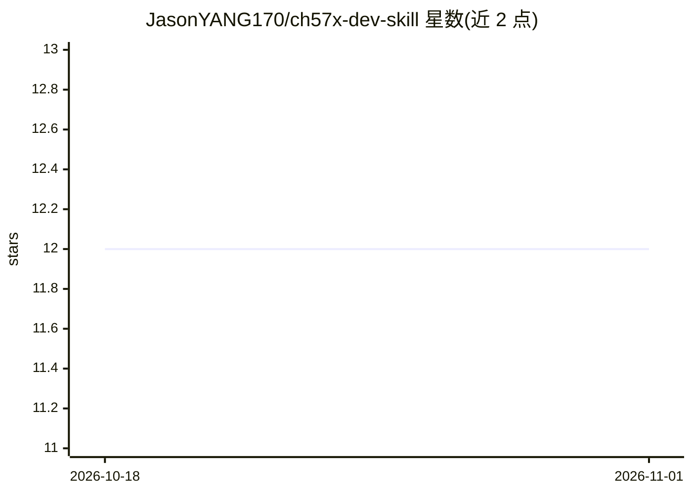

# JasonYANG170/ch57x-dev-skill

⭐ 12 · C · 推送 2026-10-02 · [GitHub](https://github.com/JasonYANG170/ch57x-dev-skill) · 个人维护 · 中文 README

**沁恒 CH57x 系列 BLE 单片机开发的 AI Agent 技能包**

面向 AI Agent 的 SKILL 形式知识包：让 Claude Code、QwenCode、OpenCode 等 Agent 按 WCH CH57x EVT SDK 规范生成嵌入式固件代码。内容由基于实际 SDK 的 API 文档、recipes 场景与 9 步工作流（计划→方案→查询→验证→确认→执行→检查→烧录→调试）构成，覆盖 BLE 全角色（外设/主机/Mesh 等）、常用外设驱动、IAP/OTA 与 USB 功能；构建依赖 MounRiver Studio，烧录用 WCH-LinkE 或 USB ISP。安装方式为 git clone 到对应 Agent 的 skills 目录。

## 筛选速览

| 维度 | 判定 | 备注 |
|---|---|---|
| AI 角色 | `ai-knowledge` | 知识聚合/清单类 |
| 许可风险 | `none` | — |
| 部署形态 | `None` |  |
| 模型依赖 | — | README 未给出锁定关系 |
| 硬件要求 | — | 无带数字的原话,不猜 |
| 安装摩擦 | `low` | 无编译、无系统依赖或容器化 |
| 成熟度 | — | 结构信号不足 |

## 能力要点

- 基于 WCH CH57x EVT SDK 实际 API 的文档与 recipes 场景
- 覆盖 BLE 全角色（Peripheral/Central/Mesh/LWNS 等）与常用外设
- 定义 9 步固件生成工作流（含验证、烧录、UART/nRF Connect 调试）
- 附带沁恒 BLE 开发手册、OTA 说明、MESH 手册等 PDF 参考资源

## 适用场景

- 让 AI Agent 生成 CH57x BLE 固件代码，减少查手册的时间
- 开发 BLE HID、Mesh、UART 透传等常见应用时直接匹配场景方案
- 新手规避 CH57x 开发的常见错误与陷阱

## 场景标签

`代码生成` · 领域:编码与开发

## 证据(README 行号)

> L5: 用于 CH57x 系列 BLE 微控制器固件开发的 AI Skill。让 AI Agent 自动生成符合 WCH SDK 规范的嵌入式代码，包括 BLE 外设/主机/Mesh 应用、外设驱动配置、IAP/OTA 升级等。
> L62: Skill 定义了一套工作流，AI Agent 在生成固件代码时会遵循：

## 星数曲线

2026-10-18 12 → 2026-11-01 12（+0）

---
*卡片 v1 · prompt 1.4 · 生成 2026-11-01 · 置信度 high · 依据 README sha `92b47a5d3c5a` · [字段定义](../../DATASET.md)*
