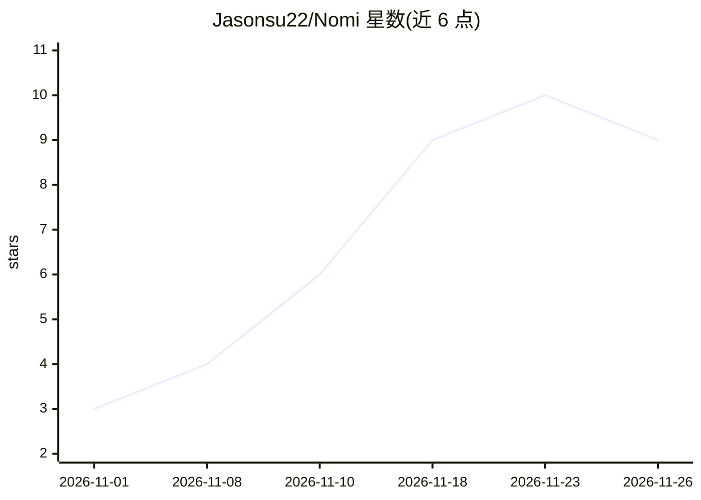

# Jasonsu22/Nomi

⭐ 9 · Swift · MIT · 推送 2026-11-22 · [GitHub](https://github.com/Jasonsu22/Nomi) · [官网](https://nomi.software/) · 个人维护 · 中文 README

**给留学生用的 Mac 端本地课堂转写翻译与学习助手**

macOS 原生应用（SwiftUI 界面 + Rust 引擎），将课堂语音实时转写为文字并逐段翻译，支持 9 种语言；自动收集课堂提问并作答、基于录音与导入文档的问答（含来源定位）、生成摘要、记住课程与偏好。识别与翻译在 Apple Silicon 上经 MLX 本地运行、可离线使用，问答可用本地模型或用户自有 API。需 macOS 26+ 与 M1 及以上芯片，以 DMG 分发，源码构建需 Xcode 与 Rust。

## 筛选速览

| 维度 | 判定 | 备注 |
|---|---|---|
| AI 角色 | `ai-native` | 本体是模型或模型工具 |
| 许可风险 | `permissive` | MIT |
| 部署形态 | `desktop` | 安装包/桌面程序 |
| 模型依赖 | — | README 未给出锁定关系 |
| 硬件要求 | — | 无带数字的原话,不猜 |
| 安装摩擦 | `low` | 无编译、无系统依赖或容器化 |
| 成熟度 | — | 结构信号不足 |

## 能力要点

- 实时语音转写并逐段翻译，可暂停续录，支持蓝牙麦克风
- 识别与翻译在本地 MLX 上运行，模型下载后可离线使用
- 跨讲座/聊天/文档的问答并标注答案出处，可选联网搜索
- 课堂问答自动收集、讲座摘要生成与学习偏好记忆

## 适用场景

- 第二语言听课时不便同时记笔记，需要实时转写与翻译
- 课后针对录音与课件向助手提问复习
- 把 90 分钟讲座压缩成要点与术语清单

## 场景标签

`语音识别` `文档问答` · 领域:知识与检索

## 证据(README 行号)

> L6:  Live transcription and translation on your Mac, with an assistant that knows your classes.
> L23: Studying in a second language is hard. The teacher talks fast, new terms are everywhere, and you can't listen and t
> L49:  Recognition and translation run on your Mac and work offline. Questions use a local model or your own API, and key

## 星数曲线

2026-11-01 3 → 2026-11-26 9（+6）

---
*卡片 v1 · prompt 1.4 · 生成 2026-11-20 · 置信度 high · 依据 README sha `0eaa2134c4e0` · [字段定义](../../DATASET.md)*
