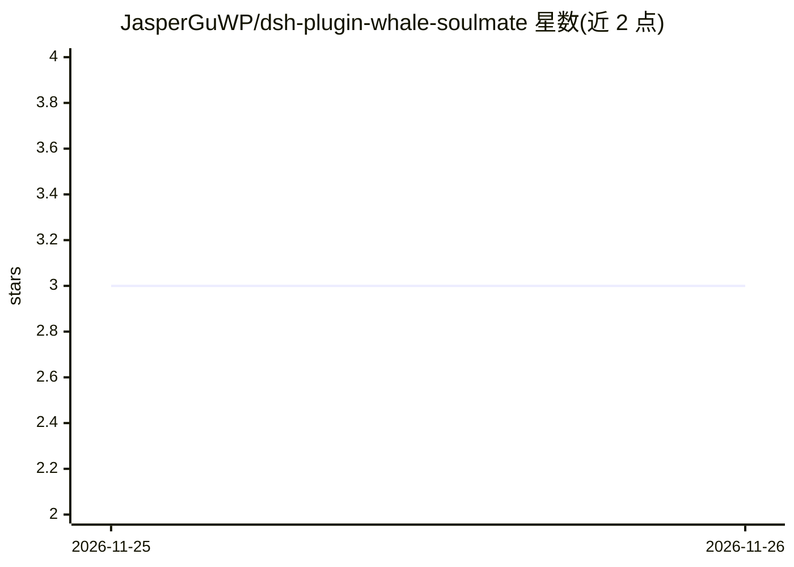

# JasperGuWP/dsh-plugin-whale-soulmate

⭐ 3 · JavaScript · MIT · 推送 2026-11-25 · [GitHub](https://github.com/JasperGuWP/dsh-plugin-whale-soulmate) · 个人维护 · 中文 README

**DeepSeek Harness 的模块化 AI 伴侣与透明视频桌宠插件**

面向 DeepSeek Harness（dsh）的可插拔插件，以 Bundle 形式提供 node + browser 两侧。功能包括人设引擎、事实/Wiki/日记混合记忆与夜间蒸馏、五道隐私防线与审计账本、7 套 VP9-alpha WebM 透明视频桌宠皮肤（部分离线内置、其余从 GitHub Releases 按需下载并 SHA-256 校验）、B 站视频理解与定时冲浪，以及微信/QQ/飞书/钉钉跨端 Bot。保留宿主 DSH 工具链，可继续执行办公与编程任务；云端同步需显式授权。

## 筛选速览

| 维度 | 判定 | 备注 |
|---|---|---|
| AI 角色 | `ai-native` | 本体是模型或模型工具 |
| 许可风险 | `permissive` | MIT |
| 部署形态 | `None` |  |
| 模型依赖 | locked-api |  |
| 硬件要求 | — | 无带数字的原话,不猜 |
| 安装摩擦 | `low` | 无编译、无系统依赖或容器化 |
| 成熟度 | — | 结构信号不足 |

## 能力要点

- 人设引擎 + LLM Wiki 混合记忆（事实/Wiki/日记、语义遗忘、3D 星云查看）
- 7 套透明视频桌宠皮肤，VP9-alpha WebM + PNG 回退，按需下载带 SHA-256 校验
- B 站视频理解与定时冲浪，字幕缺失时可调用外部 ASR
- 微信/QQ/飞书/钉钉跨端 Bot，共用同一人设与记忆

## 适用场景

- 给 DeepSeek Harness 加一个长期陪伴的桌面 AI 伙伴
- 在微信、QQ、飞书、钉钉多端使用同一个人设与记忆
- 让桌宠自动总结和巡游 B 站视频内容
- 需要私密记忆不出本地的陪伴场景（未授权云端时零外网请求）

## 场景标签

`AI 助手` `聊天机器人` `Agent 记忆` · 领域:Agent 开发

## 证据(README 行号)

> L13: 嗨～这里住着一只给 DeepSeek Harness（`dsh`）用的**模块化、可插拔 AI 小伙伴（Soulmate）** 🐋
> L27: - **无字幕也能听懂视频**：B 站官方字幕缺失或不匹配时，可从 playurl 提取音轨并调用外部 ASR；支持 OpenAI 兼容、阿里 DashScope、DeepSeek 原生和自定义 JSON 协议，并可从服务端拉取模

## 星数曲线

2026-11-25 3 → 2026-11-26 3（+0）

---
*卡片 v1 · prompt 1.4 · 生成 2026-11-24 · 置信度 high · 依据 README sha `a0984f0228f6` · [字段定义](../../DATASET.md)*
