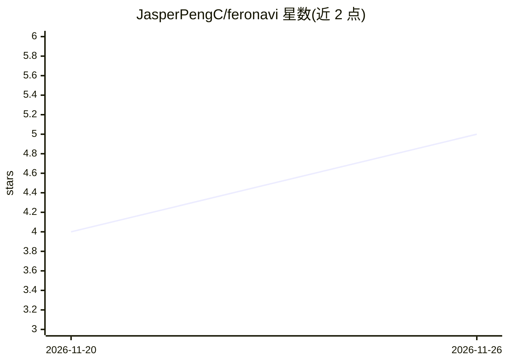

# JasperPengC/feronavi

⭐ 5 · TypeScript · AGPL-3.0 · 推送 2026-11-24 · [GitHub](https://github.com/JasperPengC/feronavi) · [官网](https://feronavi.com) · 个人维护 · 中文 README

**给团队与 Agent 的自托管项目协作平台，内置 MCP Server 与 RAG**

开源项目协作平台，覆盖需求拆解、迭代、版本、文档与审批等业务流程，支持 CRDT 多人文档协作与短时断网编辑。面向团队使用，同时提供完整 MCP Server（工具、资源、提示词，支持 Streamable HTTP 与 stdio），让 Agent 读取上下文、执行工作项操作并核验结果；内置 RAG 助手跨项目检索文档，回答引用可回到原文。通过 Docker Compose 自托管，数据留在本地，支持 OIDC/LDAP/SCIM 身份体系；默认镜像仅验收 Linux x86-64，首次从源码构建需编译数据库扩展。

## 筛选速览

| 维度 | 判定 | 备注 |
|---|---|---|
| AI 角色 | `ai-enhanced` | 去掉 AI 部分产品仍成立 |
| 许可风险 | `viral` | AGPL-3.0 |
| 部署形态 | `self-host` | docker 或自建部署 |
| 模型依赖 | — | README 未给出锁定关系 |
| 硬件要求 | — | 无带数字的原话,不猜 |
| 安装摩擦 | `low` | 无编译、无系统依赖或容器化 |
| 成熟度 | — | 结构信号不足 |

## 能力要点

- 完整 MCP Server，Agent 可读写工作项、文档、迭代与版本并核验结果
- 内置 RAG 助手，跨项目检索、引用回到原文，并经 MCP 与 OpenAPI 对外开放
- Yjs CRDT 多人实时编辑，支持短时断网继续编辑与同步合并
- 自托管部署，OIDC、LDAP/AD、2FA、SCIM 2.0 对接已有身份体系

## 适用场景

- 团队自托管一套带知识库问答的项目管理平台
- 让 AI Agent 通过 MCP 直接创建工作项、整理发布文档
- 沉淀项目方案文档，随问随用地检索历史设计依据

## 场景标签

`文档问答` `RAG` · 领域:知识与检索

## 证据(README 行号)

> L3:  让团队与 Agent，一起推进项目。
> L30: |**完整 MCP Server**|让 Agent 读取上下文、执行业务操作并核验结果|
> L31: |**内置 RAG 助手**|跨项目检索知识，结合当前业务回答，引用可回到原文|

## 星数曲线

2026-11-20 4 → 2026-11-26 5（+1）

---
*卡片 v1 · prompt 1.4 · 生成 2026-11-21 · 置信度 high · 依据 README sha `8014299bfe6a` · [字段定义](../../DATASET.md)*
