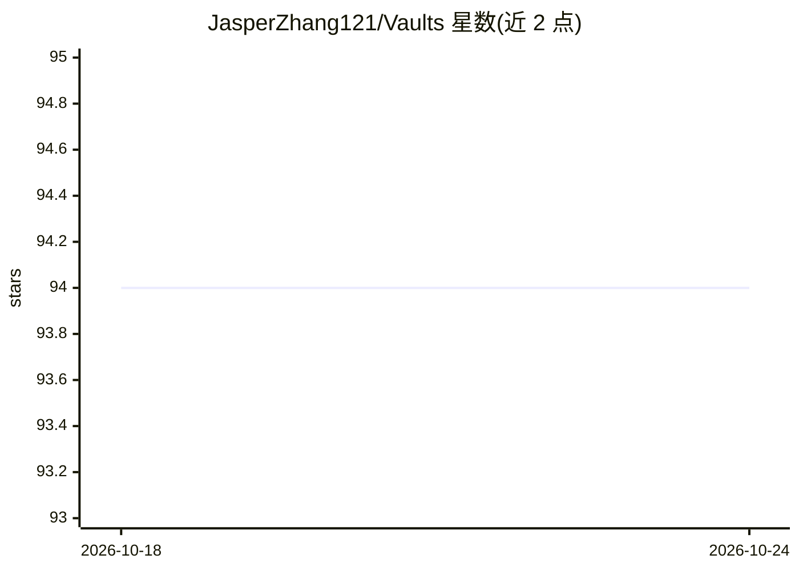

# JasperZhang121/Vaults

⭐ 94 · 推送 2026-10-24 · [GitHub](https://github.com/JasperZhang121/Vaults) · 个人维护

**个人计算机科学学习笔记库，覆盖算法、ML、大数据等主题**

个人维护的计算机科学笔记与代码片段仓库，内容涵盖算法与数据结构、C/C++/Java、操作系统、计算机网络、机器学习与大数据等。笔记以 Obsidian 格式编写，含高亮标注、内部链接与图片引用，Obsidian 用户可直接导入，并建议配合思维导图插件使用。仓库存在部分图片在 GitHub 上无法显示、跨仓库引用可能失效等已知问题，README 声明仅供个人学习参考、不用于商业用途。

## 筛选速览

| 维度 | 判定 | 备注 |
|---|---|---|
| AI 角色 | `ai-knowledge` | 知识聚合/清单类 |
| 许可风险 | `none` | — |
| 部署形态 | `None` |  |
| 模型依赖 | — | README 未给出锁定关系 |
| 硬件要求 | — | 无带数字的原话,不猜 |
| 安装摩擦 | `low` | 无编译、无系统依赖或容器化 |
| 成熟度 | — | 结构信号不足 |

## 能力要点

- Obsidian 格式笔记，含高亮、内部链接与图片引用
- 主题覆盖算法、数据结构、多语言编程、机器学习与大数据
- 近斯写作聚焦 Big Data，计划扩展 Quant 与 Fintech 方向

## 适用场景

- 作为计算机科学课程的学习参考资料
- 导入 Obsidian 后配合思维导图插件浏览笔记

## 场景标签

`教程课程` · 领域:学习与行业

## 证据(README 行号)

> L5: Welcome to my compiled notes on various aspects of computer science. My expertise spans a range of topics and you'll
> L23: - This notebook is a personal educational tool used to document my learning process in various areas of computer sc

## 星数曲线

2026-10-18 94 → 2026-10-24 94（+0）

---
*卡片 v1 · prompt 1.4 · 生成 2026-10-23 · 置信度 high · 依据 README sha `f12c2ddebbe9` · [字段定义](../../DATASET.md)*
