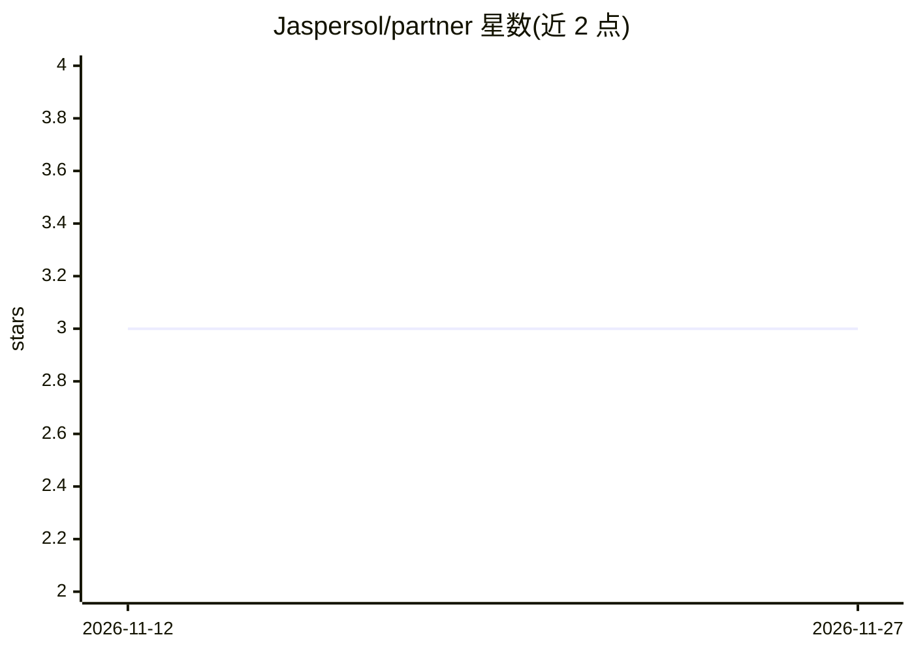

# Jaspersol/partner

⭐ 3 · C# · MIT · 推送 2026-11-24 · [GitHub](https://github.com/Jaspersol/partner) · [官网](https://github.com/Jaspersol/partner/blob/master/README.md) · 个人维护 · 中文 README

**Windows 单会话桌面 AI 助手：记忆、语音、定时与桌面控制**

面向 Windows 用户的单会话桌面 AI 助手，基于 Tauri 2 与 .NET 10 后端，安装包自带 .NET 运行时。打字、语音、定时任务与子代理报告进入同一会话日志；记忆按四层分级存于本地 SQLite，每轮结束自动蒸馏并在下一轮注入提示词；支持唤醒词、本地 ASR/TTS 引擎、cron/间隔/一次性定时任务、stdio MCP 服务器与 SKILL.md 技能。桌面控制由子代理执行，按三级审批级别限制窗口点击、文件操作与程序启动。需自行配置 OpenAI 兼容或 Anthropic 端点；仅支持 Windows 10 2004+ x64。

## 筛选速览

| 维度 | 判定 | 备注 |
|---|---|---|
| AI 角色 | `ai-native` | 本体是模型或模型工具 |
| 许可风险 | `permissive` | MIT |
| 部署形态 | `desktop` | 安装包/桌面程序 |
| 模型依赖 | — | README 未给出锁定关系 |
| 硬件要求 | `gpu-8g` | |
| 安装摩擦 | `medium` | 含编译或系统依赖之一 |
| 成熟度 | — | 结构信号不足 |

## 能力要点

- 单会话设计：输入、语音、定时与子代理报告统一排队执行
- 四层分级本地记忆，SQLite 存储并每日备份，支持中文 bigram 搜索
- 审批门控的桌面控制：按控制 ID 操作 UI Automation，含窗口白名单
- Memory Services 通过本地 OpenAI/Anthropic 兼容端点向外部插件/模组暴露记忆

## 适用场景

- 用语音与桌面助手连续对话并让其在批准后操作电脑
- 把个人记忆接入游戏 AI 模组或浏览器插件
- 按 cron 或间隔定时向助手发送指令
- 通过 MCP 与 SKILL.md 扩展助手的例行流程

## 场景标签

`AI 助手` `GUI 自动化` · 领域:效率与自动化

## 证据(README 行号)

> L3: ### A Ready-to-Use, Single-Session Desktop AI Assistant for Windows
> L5: **One continuous conversation you can type or speak to; with memory, schedules, MCP, Skills, and sub-agents that ope
> L28: - **Native Windows App** — Built with Tauri 2 and a .NET 10 backend; the installer bundles the .NET runtime

## 星数曲线

2026-11-12 3 → 2026-11-27 3（+0）

---
*卡片 v1 · prompt 1.4 · 生成 2026-11-22 · 置信度 mid · 依据 README sha `cbea022dfd45` · [字段定义](../../DATASET.md)*
