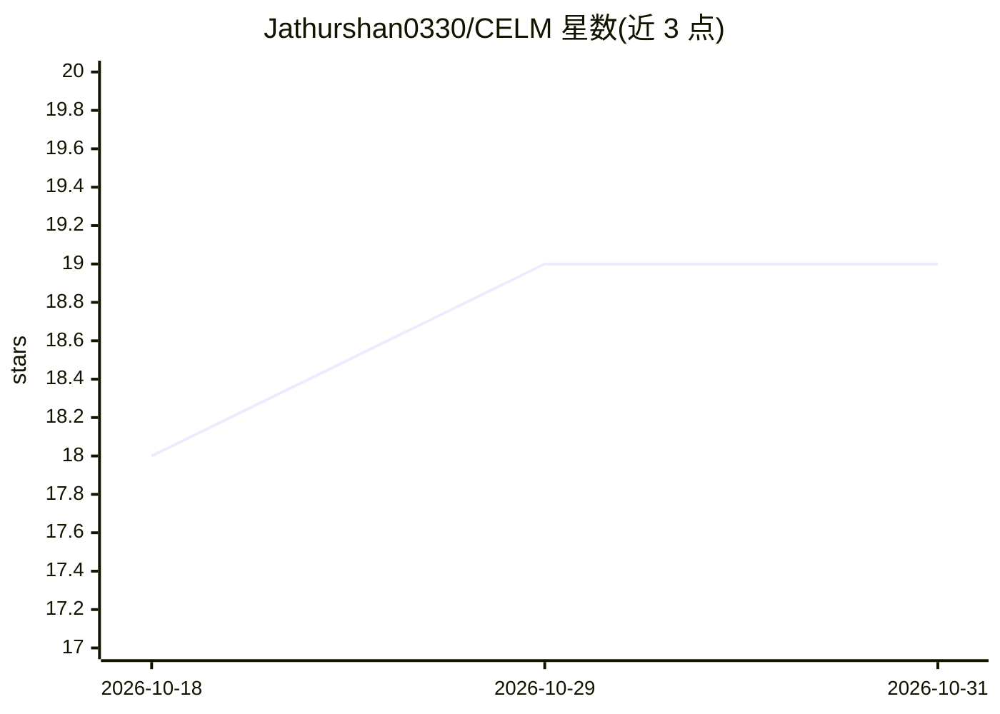

# Jathurshan0330/CELM

⭐ 19 · Python · MIT · 推送 2026-09-17 · [GitHub](https://github.com/Jathurshan0330/CELM) · [官网](https://arxiv.org/abs/2601.22197) · 组织维护

**EEG 转临床报告的生成模型：从长程脑电产出结构化临床记录**

Clinical EEG Language Model（CELM）的官方代码库：将预训练 EEG 基础模型与语言模型结合，对长时程、变长 EEG 记录做端到端临床报告生成，覆盖记录描述、背景活动、癫痫样异常、事件/发作与印象多个层级。配套发布 9,922 份报告、约 11,000 小时 EEG 的基准构建流程（数据源自 Harvard EEG Database，需自行申请访问），并提供预训练投影层权重、推理/训练脚本与单模态基线复现脚本。模型权重在 HuggingFace 发布为进行中。

## 筛选速览

| 维度 | 判定 | 备注 |
|---|---|---|
| AI 角色 | `ai-native` | 本体是模型或模型工具 |
| 许可风险 | `permissive` | MIT |
| 部署形态 | `None` |  |
| 模型依赖 | — | README 未给出锁定关系 |
| 硬件要求 | — | 无带数字的原话,不猜 |
| 安装摩擦 | `low` | 无编译、无系统依赖或容器化 |
| 成熟度 | — | 结构信号不足 |

## 能力要点

- EEG 基础模型与语言模型集成的多模态临床报告生成
- 基准含 9,922 份报告、约 11,000 小时 EEG、9,048 名患者
- 提供基准构建、推理、训练与单模态基线复现脚本
- 需要另行下载 CBraMod 检查点（HuggingFace）

## 适用场景

- 从长程 EEG 记录自动生成临床报告草稿
- 复现 EEG-报告生成基准与基线实验
- 在自有 EEG 数据上训练/微调 EEG-语言模型

## 场景标签

`多模态` `AI 写作` · 领域:内容生成

## 证据(README 行号)

> L15: We therefore develop CELM, the first clinical EEG-to-Language foundation model capable of summarizing longduration,
> L16: background activity, epileptiform abnormalities, events/seizures, and impressions. Experimental results show that, 

## 星数曲线

2026-10-18 18 → 2026-10-31 19（+1）

---
*卡片 v1 · prompt 1.4 · 生成 2026-10-29 · 置信度 high · 依据 README sha `a88cfeacf1c0` · [字段定义](../../DATASET.md)*
