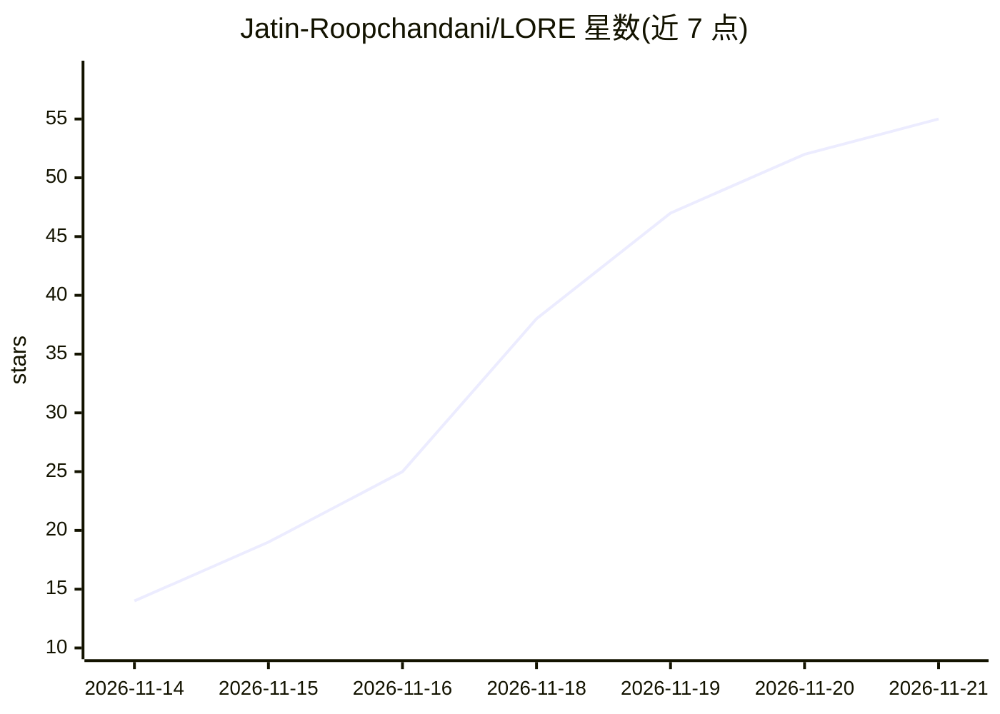

# Jatin-Roopchandani/LORE

⭐ 55 · Python · MIT · 推送 2026-11-18 · [GitHub](https://github.com/Jatin-Roopchandani/LORE) · [官网](https://lore.jrvn.site) · 个人维护

**AI 阅读器：把电子书变成知识图谱并逐句引文回答问题**

面向图书读者的开源 AI 问答应用：将 EPUB/PDF 电子书解析为章节与段落，经 LLM 抽取实体并构建 Kuzu 图与 LanceDB 向量库，回答时按图谱游走检索，每句话附原文引文并做二次核验剔除书中未述内容。支持按阅读进度做章节上限，检索层强制不泄露后续章节。可 Docker 自托管或使用托管 beta，提供 MCP 服务器供 Claude 等客户端调用。项目处于 beta 阶段，需自带模型 key（Gemini/Claude/OpenAI 或本地模型）。

## 筛选速览

| 维度 | 判定 | 备注 |
|---|---|---|
| AI 角色 | `ai-native` | 本体是模型或模型工具 |
| 许可风险 | `permissive` | MIT |
| 部署形态 | `self-host` | docker 或自建部署 |
| 模型依赖 | local-ok | 支持本地模型 |
| 硬件要求 | — | 无带数字的原话,不猜 |
| 安装摩擦 | `low` | 无编译、无系统依赖或容器化 |
| 成熟度 | `idea` | |

## 能力要点

- 电子书→实体抽取→Kuzu 图 + LanceDB 向量的 GraphRAG 流水线
- 逐句引文并二次核验，剔除书中未述内容
- 阅读进度作为章节上限，在检索/图查询/画像层强制防剧透
- MCP 服务器供 claude.ai/Claude Desktop 等客户端检索书库

## 适用场景

- 读书时向自己的电子书提问并获得可核对的引文回答
- 追踪系列图书中人物与世界观的跨书变化
- 在 Claude 中连接自己的书库提问，不越过当前阅读章节

## 场景标签

`知识图谱` `文档问答` · 领域:知识与检索

## 证据(README 行号)

> L19: LORE is an open-source AI reader for your e-books. It turns each book into a
> L33: - **Bring your own model.** Gemini (the free tier works), Claude or OpenAI for reading and writing; embeddings run 
> L102: book (EPUB/PDF) → chapters & passages → LLM extraction → entity resolution

## 星数曲线

2026-11-14 14 → 2026-11-21 55（+41）

---
*卡片 v1 · prompt 1.4 · 生成 2026-11-18 · 置信度 high · 依据 README sha `3c495db2943a` · [字段定义](../../DATASET.md)*
