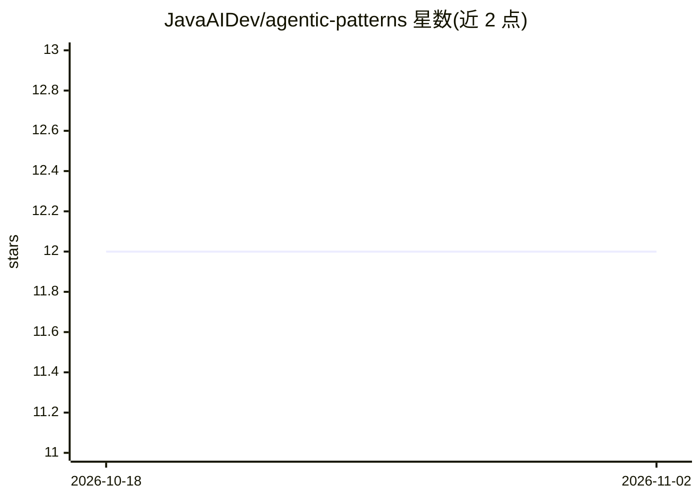

# JavaAIDev/agentic-patterns

⭐ 12 · Java · Apache-2.0 · 推送 2026-06-16 · [GitHub](https://github.com/JavaAIDev/agentic-patterns) · [官网](https://javaaidev.com/docs/agentic-patterns/intro) · 组织维护

**基于 Spring AI 的 Agentic 工作流与模式参考实现**

以 Java/Spring Boot 为技术栈、基于 Spring AI 2.0.0 的 Agentic 工作流与设计模式参考实现，要求 Java 21（用于虚拟线程）。通过 Maven 构建并发布至 Maven Central，供 Java 开发者在 Spring 生态中构建 agent 应用时参照实现。README 信息有限，未展示具体模式清单与运行方式。

## 筛选速览

| 维度 | 判定 | 备注 |
|---|---|---|
| AI 角色 | `ai-ecosystem` | LLM/agent 周边工具 |
| 许可风险 | `permissive` | Apache-2.0 |
| 部署形态 | `None` |  |
| 模型依赖 | — | README 未给出锁定关系 |
| 硬件要求 | — | 无带数字的原话,不猜 |
| 安装摩擦 | `medium` | 含编译或系统依赖之一 |
| 成熟度 | — | 结构信号不足 |

## 能力要点

- Agentic Workflow & Patterns 的参考实现
- 基于 Spring AI 2.0.0 与 Spring Boot
- 要求 Java 21（虚拟线程）
- 构件发布于 Maven Central

## 适用场景

- 在 Spring 生态中搭建 agent 工作流时参照其实现
- 学习 Java 技术栈下的 agentic 模式写法

## 场景标签

`Agent 框架` · 领域:Agent 开发

## 证据(README 行号)

> L6: Reference implementation of Agentic Workflow and Patterns
> L11: - Spring AI (Current version `2.0.0`)

## 星数曲线

2026-10-18 12 → 2026-11-02 12（+0）

---
*卡片 v1 · prompt 1.4 · 生成 2026-11-01 · 置信度 low · 依据 README sha `088fd2aa0e32` · [字段定义](../../DATASET.md)*
