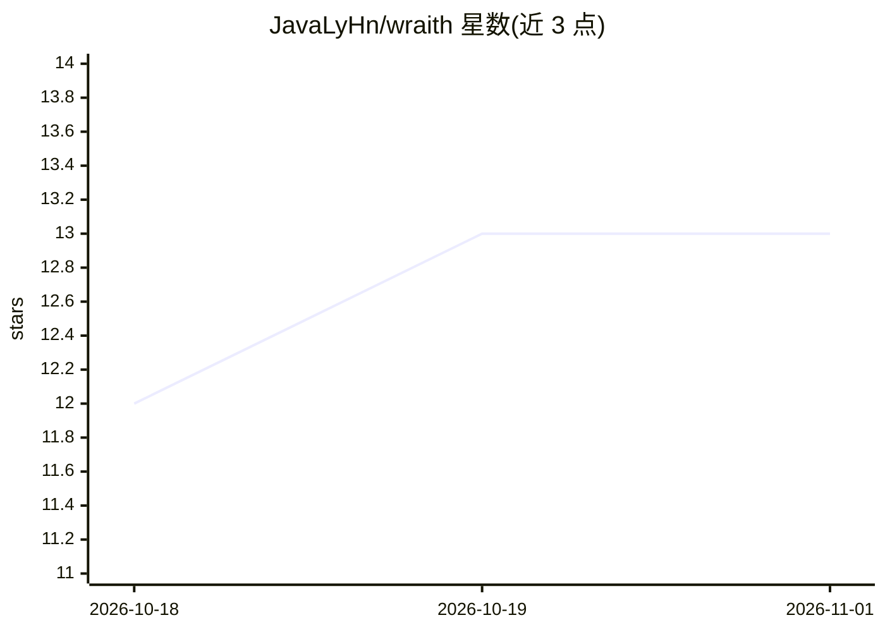

# JavaLyHn/wraith

⭐ 13 · Java · GPL-3.0 · 推送 2026-09-01 · [GitHub](https://github.com/JavaLyHn/wraith) · [官网](https://github.com/JavaLyHn/wraith/releases/latest) · 个人维护 · 中文 README

**运行在本机的 AI 编程 Agent，终端/桌面/IM 网关三形态**

Java 内核的编程 Agent，同一套配置、会话、记忆与工具支持三种形态：终端 CLI、桌面 App（11 个面板）与常驻 IM 网关（QQ/飞书/企业微信/微信）。可读写代码、执行命令、语义检索、接管浏览器、MCP 与 Skill 扩展；提供 ReAct/Plan/Multi-Agent 三种编排与六层安全防线（路径围栏、命令黑名单、HITL 审批、OS 级沙箱、资源上限、审计日志）。macOS 提供自带 JRE 的 dmg，Windows/Linux 需从源码构建；Release 当前只发 mac 版。

## 筛选速览

| 维度 | 判定 | 备注 |
|---|---|---|
| AI 角色 | `ai-native` | 本体是模型或模型工具 |
| 许可风险 | `viral` | GPL-3.0 |
| 部署形态 | `desktop` | 安装包/桌面程序 |
| 模型依赖 | local-ok | 支持本地模型 |
| 硬件要求 | — | 无带数字的原话,不猜 |
| 安装摩擦 | `high` | 编译与系统依赖俱全 |
| 成熟度 | — | 结构信号不足 |

## 能力要点

- CLI/桌面/IM 网关三形态共用同一份配置、会话与记忆
- 六层安全防线：路径围栏、命令黑名单、HITL 审批、Seatbelt/AppContainer 沙箱、资源上限、审计日志
- ReAct / Plan-and-Execute / Multi-Agent 三种编排模式
- Side-Git 独立快照仓库，每轮对话前后自动存档可回滚

## 适用场景

- 在项目目录里让 agent 读写代码、跑命令并完成多步编程任务
- 人不在电脑前时通过 QQ/飞书/微信发消息让 agent 干活并走卡片审批
- 用桌面 App 图形化配置模型、审批危险操作与查看 diff

## 场景标签

`编码 Agent` `多智能体` · 领域:Agent 开发

## 证据(README 行号)

> L7: **一个在你自己机器上跑的编程 Agent。** 读写代码、跑命令、查资料、开浏览器，
> L8: 危险操作停下来等你点头。同一套 Java 内核有三种用法：**终端 CLI**、**桌面 App**、
> L244: - **IM 网关**：QQ / 飞书 / 企业微信 / 微信，手机上发消息，审批走卡片

## 星数曲线

2026-10-18 12 → 2026-11-01 13（+1）

---
*卡片 v1 · prompt 1.4 · 生成 2026-10-31 · 置信度 mid · 依据 README sha `f0fdd1295340` · [字段定义](../../DATASET.md)*
