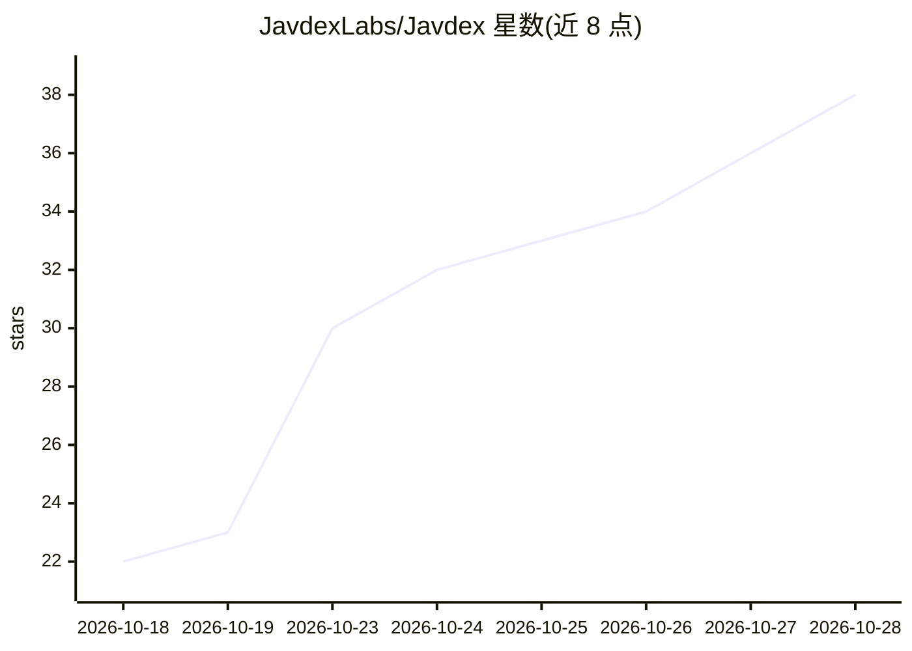

# JavdexLabs/Javdex

⭐ 38 · TypeScript · GPL-3.0 · 推送 2026-10-27 · [GitHub](https://github.com/JavdexLabs/Javdex) · [官网](https://javdexlabs.github.io/Javdex/) · 组织维护 · 中文 README

**本地 JAV 影片库管理工具：自动建库、刮削资料、AI 字幕**

以番号为核心的本地媒体库管理软件：扫描目录自动识别番号建库，支持本地视频、STRM、直链、网页、Magnet、ED2K 等多种资源形态；通过刮削插件补齐标题、封面、演员与标签，不确定结果进入待确认。内置基于 libmpv 的播放器，提供本机推理的日译中 AI 字幕与本地人脸检测裁切头像；兼容 MDC、MDCx、Javinizer、JavSP 的 NFO 导入及 Kodi、Jellyfin 等导出。提供 Windows/macOS/Linux 安装包，也可用 Docker 部署服务端到 NAS，浏览器访问。

## 筛选速览

| 维度 | 判定 | 备注 |
|---|---|---|
| AI 角色 | `ai-enhanced` | 去掉 AI 部分产品仍成立 |
| 许可风险 | `viral` | GPL-3.0 |
| 部署形态 | `None` |  |
| 模型依赖 | — | README 未给出锁定关系 |
| 硬件要求 | — | 无带数字的原话,不猜 |
| 安装摩擦 | `low` | 无编译、无系统依赖或容器化 |
| 成熟度 | — | 结构信号不足 |

## 能力要点

- 扫描目录自动识别番号建库，支持本地视频、STRM、直链、Magnet、ED2K
- 刮削插件批量补齐标题、封面、演员与标签，不确定结果进入待确认
- 内置 libmpv 播放器与本机推理的日中 AI 字幕，不上传音频
- 导入 MDC/MDCx/Javinizer/JavSP 的 NFO，可导出给 Kodi/Jellyfin/Emby/Plex

## 适用场景

- 把散落的影片文件整理成有封面有资料的可播放媒体库
- NAS 上常驻扫描，手机平板电视浏览器直接观看
- 复用已有刮削工具生成的 NFO 资料，或导出到 Kodi/Jellyfin

## 场景标签

 · 领域:媒体库管理/桌面应用

## 证据(README 行号)

> L31: - **扫描即建库**：选好目录，自动识别文件名中的番号，跳过样片和预告；本地视频、STRM、直链、网页、Magnet、ED2K 都能挂到同一部影片下。
> L34: - **本地 AI 日中字幕**：边看边为日语对白生成中文字幕，模型在本机推理，不上传音频。
> L36: - **已有资料直接复用**：导入 MDC、MDCx、Javinizer、JavSP 生成的 NFO；也可导出给 Kodi、Jellyfin、Emby、Plex、Infuse。

## 星数曲线

2026-10-18 22 → 2026-10-28 38（+16）

---
*卡片 v1 · prompt 1.4 · 生成 2026-10-25 · 置信度 high · 依据 README sha `eaf2cf8593dc` · [字段定义](../../DATASET.md)*
