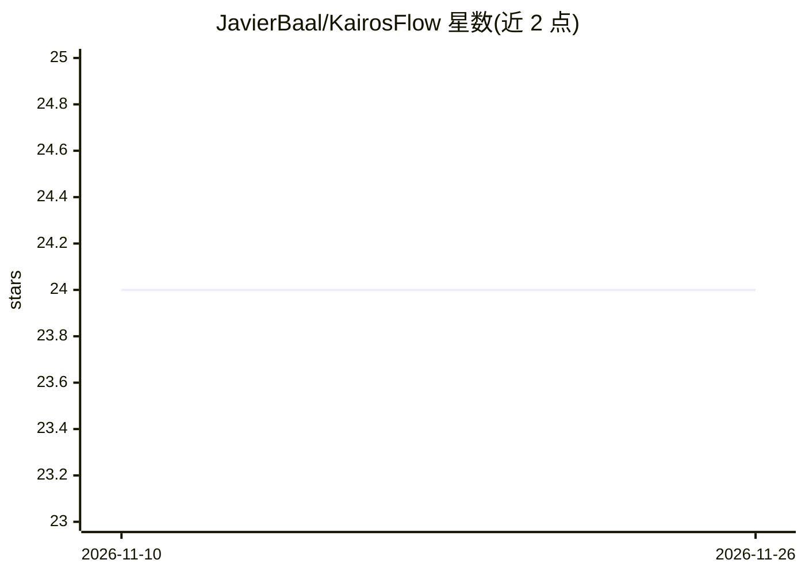

# JavierBaal/KairosFlow

⭐ 24 · TypeScript · MIT · 推送 2026-11-10 · [GitHub](https://github.com/JavierBaal/KairosFlow) · [官网](https://www.vanguardhive.com) · 个人维护

**构建多智能体 LLM 流水线的 CLI 框架，步骤间校验 JSON**

TypeScript 命令行框架，用于编排多智能体 LLM 流水线：每个 agent 对应一个 Markdown 提示词，只接收声明的上下文，输出必须解析为 JSON 并可校验 JSON Schema，失败则带错误重试，仍失败即停止。框架自身写入时间戳、token 数、尝试次数等元数据并存为 artifacts，并提供本地 Web 仪表盘、生命周期插件与自定义 provider。支持 OpenAI、Anthropic、DeepSeek 及 OpenAI 兼容端点。限制：仅校验结构不校验真实性、步骤串行执行、仪表盘为最小化工具。未发布到 npm，需从 GitHub 安装，要求 Node 20+。自我声明为研究项目。

## 筛选速览

| 维度 | 判定 | 备注 |
|---|---|---|
| AI 角色 | `ai-ecosystem` | LLM/agent 周边工具 |
| 许可风险 | `permissive` | MIT |
| 部署形态 | `library` | 以包/库形式分发 |
| 模型依赖 | locked-api |  |
| 硬件要求 | — | 无带数字的原话,不猜 |
| 安装摩擦 | `low` | 无编译、无系统依赖或容器化 |
| 成熟度 | `idea` | |

## 能力要点

- 步骤间 JSON/JSON Schema 校验，失败自动带错误重试
- 每个 agent 可声明只接收指定前序输出，控制上下文
- 元数据由框架写入而非模型，每步存为 artifact
- 生命周期插件、自定义 provider 与本地仪表盘

## 适用场景

- 把长提示词拆成小 agent 串行流水线并逐步校验输出
- 需要可追溯运行记录（时间戳、token 数、尝试次数）的 LLM 任务
- 用本地或 DeepSeek 等低成本端点跑廉价流水线

## 场景标签

`多智能体` · 领域:Agent 开发

## 证据(README 行号)

> L6: A command-line framework for multi-agent LLM pipelines. Each agent does one job, returns JSON, and the framework che
> L18: - **Works with several providers.** OpenAI, Anthropic, DeepSeek, and any OpenAI-compatible endpoint (including loca

## 星数曲线

2026-11-10 24 → 2026-11-26 24（+0）

---
*卡片 v1 · prompt 1.4 · 生成 2026-11-18 · 置信度 high · 依据 README sha `389f8dc34c49` · [字段定义](../../DATASET.md)*
