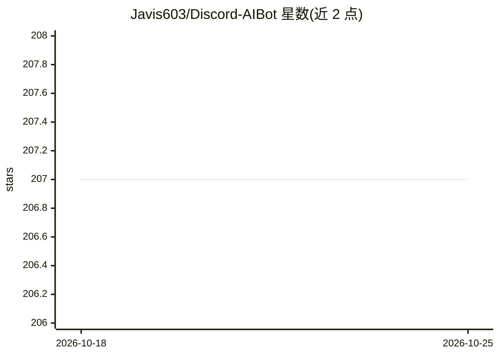

# Javis603/Discord-AIBot

⭐ 207 · JavaScript · MIT · 推送 2026-05-13 · [GitHub](https://github.com/Javis603/Discord-AIBot) · [官网](https://discord.gg/HmdNVVvw5P) · 个人维护 · 中文 README

**Discord 多模型 AI 助手机器人：对话、画图、搜索**

基于 Node.js (discord.js) 的 Discord AI 助手机器人，通过 OpenAI API 格式接入 OpenAI、DeepSeek、Google AI、xAI、Anthropic（需代理 API）等模型，支持模型灵活切换、流式回复、多轮对话记忆、语音/图像/PDF 多模态输入、AI 生图与 Tavily 网络搜索、深度思考模式，并提供对话预测建议与可扩展 AI Skills。界面本地化为简繁中文/英/日四种语言，使用 MongoDB 持久化数据。需 Node.js 18+、MongoDB 与各 AI API Key，通过 git clone + npm install 部署。

## 筛选速览

| 维度 | 判定 | 备注 |
|---|---|---|
| AI 角色 | `ai-native` | 本体是模型或模型工具 |
| 许可风险 | `permissive` | MIT |
| 部署形态 | `library` | 以包/库形式分发 |
| 模型依赖 | locked-api |  |
| 硬件要求 | — | 无带数字的原话,不猜 |
| 安装摩擦 | `low` | 无编译、无系统依赖或容器化 |
| 成熟度 | — | 结构信号不足 |

## 能力要点

- 通过 OpenAI API 格式接入 OpenAI/DeepSeek/Google AI/xAI/Anthropic 等多模型并支持切换
- 文本/图像/PDF/语音多模态输入与流式回复
- AI 生图（多风格/提示词优化/多尺寸）与 Tavily 网络搜索
- 四种语言本地化与可扩展 AI Skills 结构

## 适用场景

- 在 Discord 服务器里部署可切换模型的 AI 聊天助手
- 用斜杠命令生成 AI 图片或进行网络搜索问答
- 多人社区中按用户/服务器设置语言与 AI 角色

## 场景标签

`聊天机器人` `图像生成` · 领域:对话与助手

## 证据(README 行号)

> L14: This is a multifunctional AI assistant designed for Discord, integrating top-tier AI models like OpenAI, Gemini, Cl
> L75: |Model|Status|Base URL (supports OpenAI API format only)|

## 星数曲线

2026-10-18 207 → 2026-10-25 207（+0）

---
*卡片 v1 · prompt 1.4 · 生成 2026-10-22 · 置信度 high · 依据 README sha `11aad3a35ce6` · [字段定义](../../DATASET.md)*
